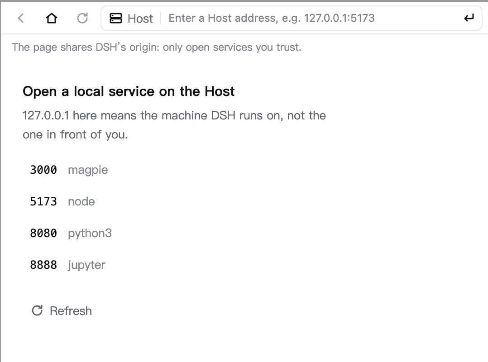
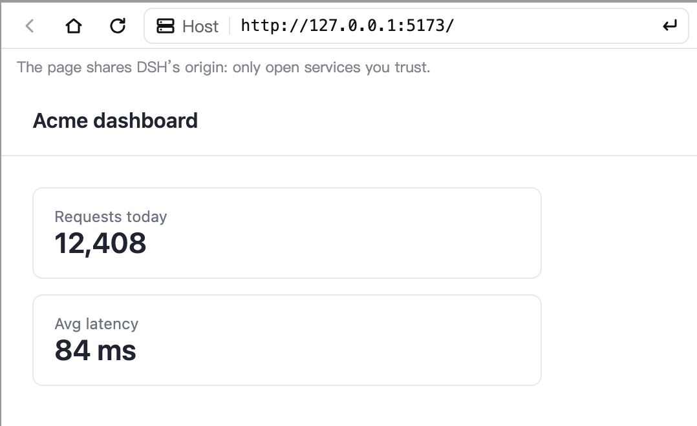

# dsh-host-browsing

English · [简体中文](README.zh.md)

 

*Left: the home page lists the Host's web services, each port followed by the actual process name on the Host. Right: one opened in the tab. Captured from an isolated test instance with a stand-in services list and a synthetic sample page.*


<!-- problem -->
When DSH drives a remote machine, open that machine's own localhost services right in the sidebar, with no per-port SSH tunnels. The tab reaches the Host's `127.0.0.1:<port>` through DSH's own web server, over the link DSH already uses.

## Features

- A home page listing the Host's web services (port and process name); one click opens one.
- Type `127.0.0.1:5173`, `localhost:3000` or `[::1]:8080`; pages see the direct address.
- Dev apps keep working: SPA routing, forms, cookies, HMR WebSockets.
- Back, Home and Refresh in the toolbar; English and Chinese UI.

## Install

```sh
dsh plugin --profile web add dsh-host-browsing
```

Needs DSH `>=0.2.2-rc.1`, the `dsh-better-sidebar` plugin and a Chromium-family browser.

## Usage

Open the tab, click a listed service or type an address with an explicit port.

| Input | Address bar |
|---|---|
| `localhost:5173/app?x=1` | `http://127.0.0.1:5173/app?x=1` |
| `[::1]:8080/` | `http://[::1]:8080/` |

## Security and limits

- Proxied pages share DSH's origin: only open services you trust. Every request needs a DSH session.
- Chromium only; without `dsh-better-sidebar` nothing is registered.
- Requests from Workers and nested iframes may reach loopback of your own computer.
- Non-HTML responses (JSON, text, PDF) are not shown in the tab.
- Only loopback HTTP targets on the Host; no HTTPS upstreams.

## How it differs from dsh-tunnel

`@mzzsfy/dsh-tunnel` (we read its 0.4.0 source) opens a port in Settings and serves it at `/p/<name>/` or `<name>.*` in a separate browser tab, with AI tools and a request log; its path mode strips the prefix and fixes redirect `Location` headers. dsh-host-browsing browses Host-local pages inside a sidebar tab via a same-origin proxy and Service Worker rewriting; the two can coexist.

## Development

`npm run build && npm run typecheck && npm test` in this directory; `npm run test:browser` needs a local Chrome (`DSHLS_CHROME`).

## Removal

<!-- section: removal -->
Run `dsh plugin --profile web remove dsh-host-browsing` (in the ohmydsh repo: `enabled: false`, `dsh build`) and restart DSH. Routes and the tab disappear and the plugin unregisters its Service Worker; if a browser still holds it, unregister the `/dsh-local-service/` scope in DevTools → Application → Service Workers.

## Maintenance

Maintained in [ohmydsh](https://github.com/prgrmrwy/ohmydsh); this repository is the release mirror. MIT, see [LICENSE](LICENSE); issues and PRs welcome.
