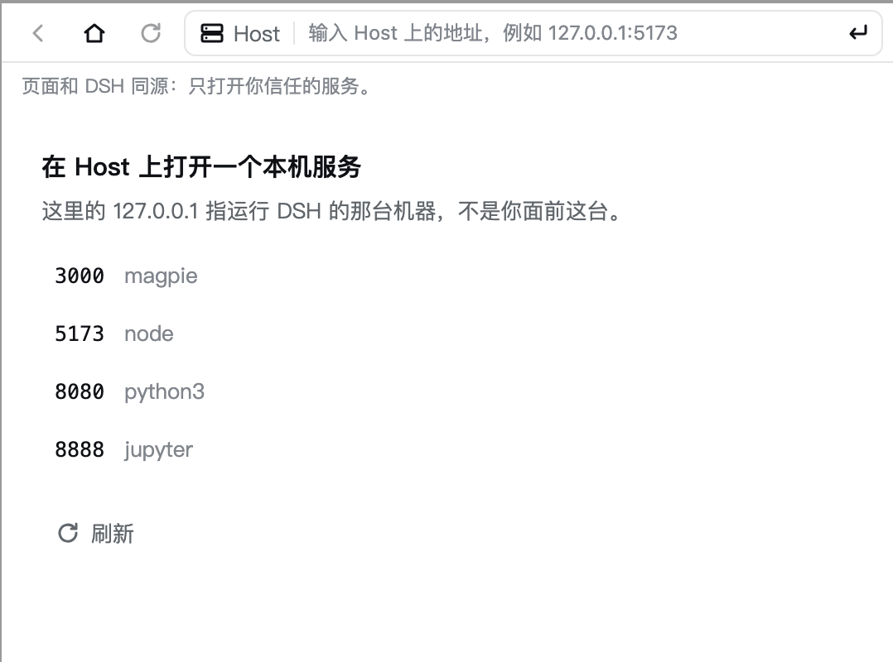
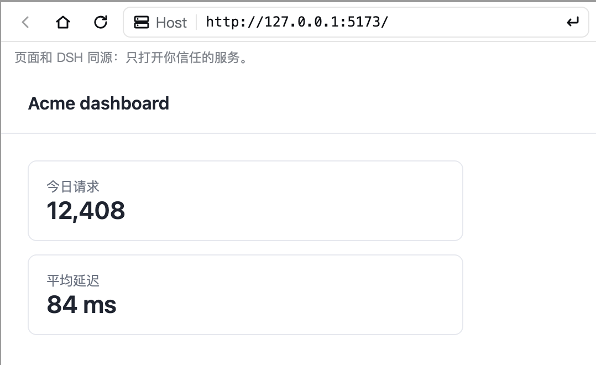

# dsh-host-browsing

[English](README.md) · 简体中文

 

*左：首页列出 Host 上的网页服务，端口后显示 Host 上实际的进程名。右：点开其中一个，在 tab 内显示。截图来自隔离的测试实例，服务列表为替身数据，页面为合成样例。*


<!-- problem -->
通过 DSH 远程控制另一台机器时，在侧栏直接打开那台机器上的 localhost 服务，不用为每个端口手建 SSH 隧道。tab 经 DSH 自己的 web server、走 DSH 已有的连接访问 Host 的 `127.0.0.1:<端口>`。

## 特点

- 首页列出 Host 上的网页服务（端口和进程名），点一下即可打开。
- 输入 `127.0.0.1:5173`、`localhost:3000` 或 `[::1]:8080`；页面看到的是直接地址。
- 常见开发应用照常工作：SPA 路由、表单、cookie、HMR WebSocket。
- 工具栏有返回、首页、刷新；界面支持中英文。

## 安装

```sh
dsh plugin --profile web add dsh-host-browsing
```

需要 DSH `>=0.2.2-rc.1`、`dsh-better-sidebar` 插件和 Chromium 系浏览器。

## 使用

打开 tab，点一个列出的服务，或输入带显式端口的地址。

| 输入 | 地址栏显示 |
|---|---|
| `localhost:5173/app?x=1` | `http://127.0.0.1:5173/app?x=1` |
| `[::1]:8080/` | `http://[::1]:8080/` |

## 安全与限制

- 被代理页面与 DSH 同源：只打开你信任的服务。每个请求都需要 DSH 会话。
- 仅 Chromium；没有 `dsh-better-sidebar` 时不会注册任何东西。
- Worker 和嵌套 iframe 发出的请求可能落到你自己电脑的回环地址。
- 非 HTML 响应（JSON、文本、PDF）不会在 tab 中显示。
- 只代理 Host 回环上的 HTTP 目标；不支持 HTTPS 上游。

## 与 dsh-tunnel 的区别

`@mzzsfy/dsh-tunnel`（我们阅读了其 0.4.0 源码）在设置中开放端口后，用 `/p/<name>/` 或 `<name>.*` 在新的浏览器标签页访问，并提供 AI 工具和请求日志；其 path 模式只剥离前缀并补全重定向的 `Location`。dsh-host-browsing 通过同源代理和 Service Worker 改写，在侧栏 tab 内浏览 Host 本机页面；两者可以并存。

## 开发

在本目录运行 `npm run build && npm run typecheck && npm test`；`npm run test:browser` 需要本机 Chrome（`DSHLS_CHROME`）。

## 移除

<!-- section: removal -->
运行 `dsh plugin --profile web remove dsh-host-browsing`（在 ohmydsh 仓库内：`enabled: false`，`dsh build`）并重启 DSH。路由和 tab 随之消失，插件卸载时会注销自己的 Service Worker；若浏览器仍残留，在 DevTools → Application → Service Workers 中注销 `/dsh-local-service/` 作用域。

## 维护

本插件在 [ohmydsh](https://github.com/prgrmrwy/ohmydsh) 中持续维护，本仓库是发布镜像。MIT 许可，见 [LICENSE](LICENSE)；欢迎 issue 和 PR。
