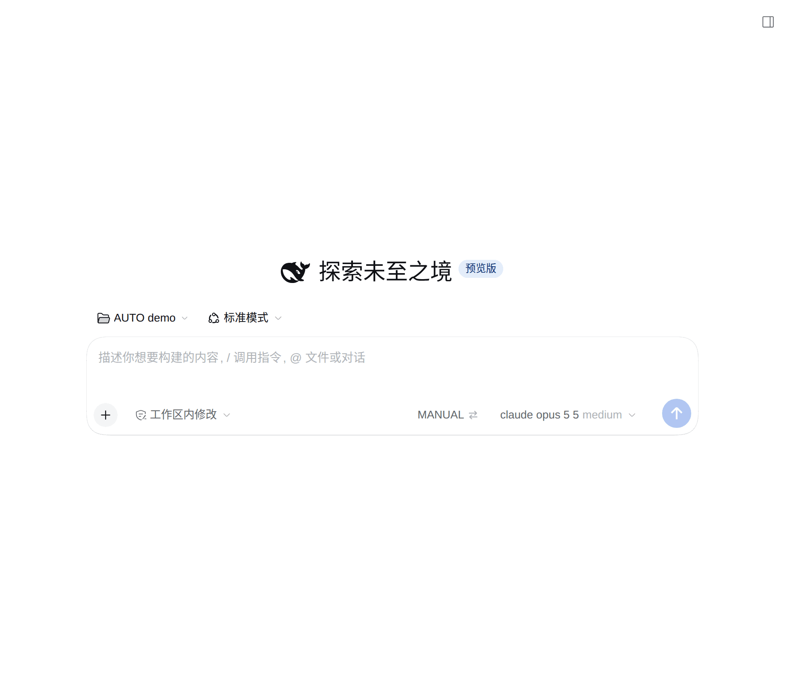
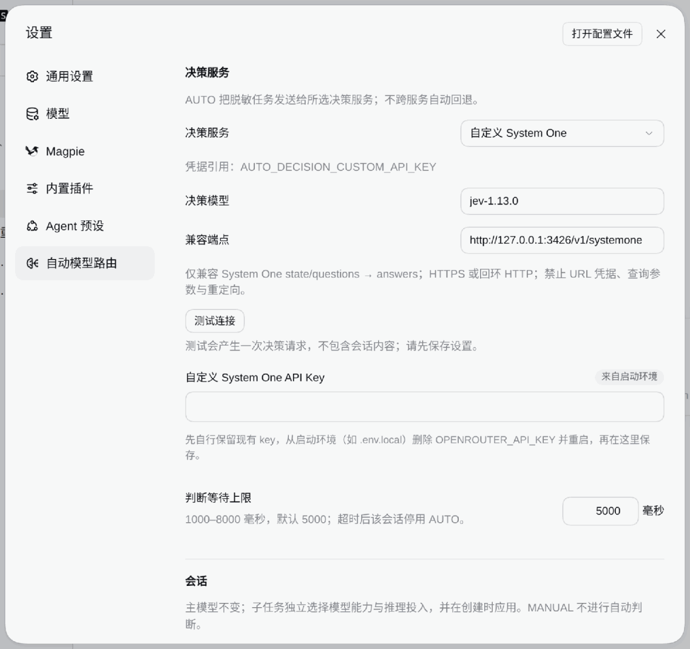

# dsh-auto-model-routing

English · [简体中文](README.zh.md)



<!-- problem -->
You should not have to raise or lower reasoning effort by hand for every message. In AUTO, each user turn is judged by the Jev decision model (via OpenRouter) as `simple` / `standard` / `complex` / `escalated`, and the plugin changes **only the reasoning effort** of the model you already picked. Provider and model are never changed. If Jev fails for any reason, AUTO switches itself off and the chip shows why.

**Install.** DSH `0.2.0-rc.2`, Node.js `>=22.19`.

```sh
dsh plugin --profile web add dsh-auto-model-routing
# Or install source (approve the local build when prompted):
dsh plugin --profile web add prgrmrwy/dsh-auto-model-routing
```

Restart DSH, refresh the Web page, then configure your OpenRouter key in **Settings → 自动模型路由**. The companion skill is included; it guides delegation but does not enforce every dispatch. Unlike model-pool routers or local classifiers, this plugin uses external Jev judgments and never switches the main model. The demos use an isolated Host with local mock Jev/model responses.

In [ohmydsh](https://github.com/prgrmrwy/ohmydsh), enable only the local `auto-model-routing` entry and run `dsh build`; no separate skill customization is needed.

## Use

| Where | What you do |
|---|---|
| **AUTO / MANUAL chip** (left of the model picker) | Click to switch. Hover to see this turn's effort, the latest Jev decision and its distribution. |
| **Decision hint** | Appears above the chip for 3 s after each judgment, e.g. `complex → high · 0.70s`. |
| **Gauge button** on a reply | Hover for the judgment; click to record which tier the turn should have used. |
| **Settings → 自动模型路由** | OpenRouter key, default mode, effort cap, Jev deadline, hint switch and the routing maps (below). |



**Default effort.** Each model starts at its officially recommended effort: `standard` keeps it, `simple` goes one step down, `complex` one up, `escalated` two up. The result is capped (default `xhigh`), and AUTO never picks `max`. Each cell of the routing map can override this: main efforts apply to every model of a provider family, and sub-agent cells are full model + effort pairs.

**Sub-agents.** The `route_subagent` tool uses the same judgment and returns provider/model/effort (Claude: Haiku → Sonnet → Opus → Opus; GPT: Luna → Sol → Sol → Sol). It only judges when the root chat is AUTO, and otherwise returns `routed: false`. These routes must be in the official sub-agent allowlist, which is fixed when a chat is created.

## AUTO automatic resource selection (default)

AUTO now directly uses independent capability and effort judgments; no version selector or extra activation is required. Earlier four-tier examples describe only the explicit legacy rollback. The main model stays fixed. Official fresh `subagent` / `spawn_teammate` calls bind decisions to exact child IDs before the first request; persisted decisions are replayed on resume. The legacy tier tables remain unchanged and apply only to the original policy.

Here `route_subagent` is an optional **preview**, not proof of application; do not copy a preview as an explicit user constraint. Explicit model/effort are preserved. Fork remains unsupported until real-provider history compatibility is verified; unbound creation paths stop rather than silently claim routing. Use the `auto-model-routing.childRouting` RPC with `{sessionId}` for `recommended/applied/unsupported/needs-context/failed` evidence. Applied means the actual request configuration matched, not that the task succeeded.

Switching to MANUAL/legacy stops new decisions; existing bound children retain their initial route. Disabling the plugin removes replay and lets the host restore its original creation configuration. See [Jev validation](docs/jev-policy-v2-validation.md) and [development verification / coverage](docs/policy-v2-development.md). The user approved default promotion on 2026-10-25 after minimal real Magpie acceptance. Set `policy: legacy` only for rollback via configuration/RPC; historical mappings are retained. Broader task-quality benefits remain unverified.

## Good to know

- **New chats default to MANUAL.** You can change this in Settings.
- **Fail closed.** No key, out of credits, rate limit, region block, timeout or a bad reply: the chat goes to `MANUAL · Jev 停用` with the reason. Click AUTO to retry. There is no local fallback and no retry.
- **MANUAL only stops changes.** The chat keeps the last effort AUTO set. AUTO also writes it into the official selection, so new chats start from it.
- **Data sent out.** In AUTO, every user turn sends up to 8000 characters of your message and short parts of the previous turn to OpenRouter / TypeSafe (`typesafe/jev-1.13`). The text is redacted by shape first (keys, tokens, URL credentials, IPs). This is best effort and does not guarantee that every secret is removed.
- **The key** is stored through the official DSH credentials service, never in the plugin config. A key in the launch environment (`OPENROUTER_API_KEY`) takes precedence and is read-only. To move it to the GUI, remove it from the launch environment, restart once, then save it in Settings.
- **Files.** Settings live in `$DSH_HOME/plugins/dsh-auto-model-routing/config.json`; per-chat mode and judgments live in `$DSH_HOME/state/auto-model-routing/`. Changes take effect on the next request; no restart is needed.

## Architecture
<!-- section: architecture -->



An `agent/pre-step` hook judges step 1 of each user turn. An `agent/request` hook (prepended) then rewrites only `reasoningEffort`, and syncs it to the official model selection. Entry point: [`src/index.ts`](https://github.com/prgrmrwy/dsh-auto-model-routing/blob/main/src/index.ts). Rubric: [`src/rubric.json`](https://github.com/prgrmrwy/dsh-auto-model-routing/blob/main/src/rubric.json). Effort table: [`src/effort.ts`](https://github.com/prgrmrwy/dsh-auto-model-routing/blob/main/src/effort.ts). UI: [`src/client/`](https://github.com/prgrmrwy/dsh-auto-model-routing/blob/main/src/client/index.ts). Regression cases: [`eval/`](https://github.com/prgrmrwy/dsh-auto-model-routing/blob/main/eval/README.md). Diagram source: [`docs/architecture.json`](docs/architecture.json) (archify).

## Development

```sh
npm test
npm run typecheck
npm run build
```

Tests use the real AgentLoop with a fake LLM stream and a loopback fake Jev; they never call OpenRouter. `node scripts/label-report.mjs` summarizes your tier labels per rubric version.

Specs and design: the current spec is [`openspec/specs/auto-model-routing`](https://github.com/prgrmrwy/ohmydsh/blob/main/openspec/specs/auto-model-routing/spec.md). The archived changes record the design history: [routing](https://github.com/prgrmrwy/ohmydsh/blob/main/openspec/changes/archive/2026-10-22-auto-model-routing/design.md) (decisions D1–D14) and [settings](https://github.com/prgrmrwy/ohmydsh/blob/main/openspec/changes/archive/2026-10-23-auto-model-routing-settings/design.md). The companion skill is [`skills/subagent-model-routing`](skills/subagent-model-routing/SKILL.md). Before you change the hooks, read [DSH plugin integration pitfalls](https://github.com/prgrmrwy/ohmydsh/blob/main/docs/architecture/dsh-plugin-integration-pitfalls.md).

## Removal
<!-- section: removal -->

Run `dsh plugin --profile web remove dsh-auto-model-routing`, then restart DSH and refresh the page. In ohmydsh, set `enabled: false` and rebuild instead. The plugin-owned skill and tools disappear; settings and logs remain. Chats keep the last effort AUTO set until you pick another one.
