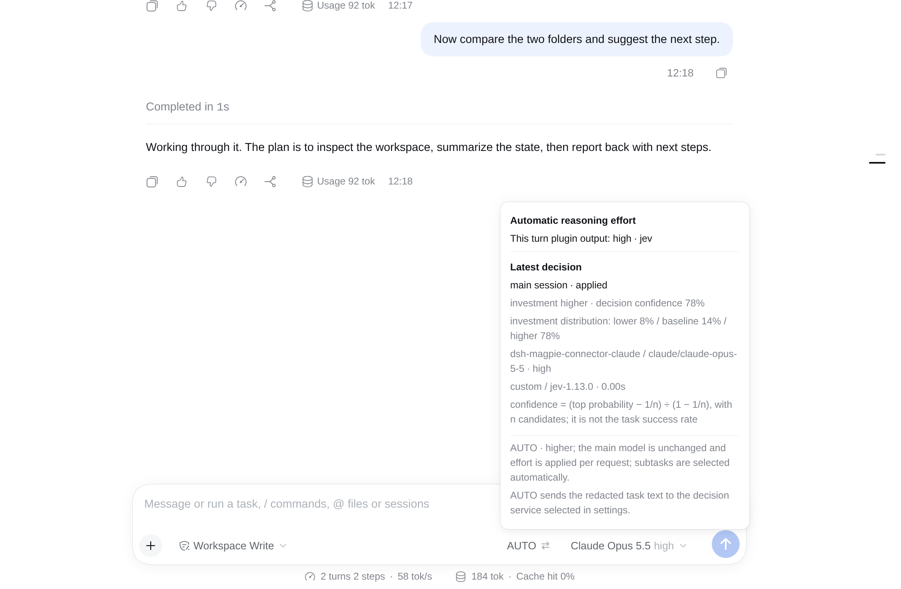
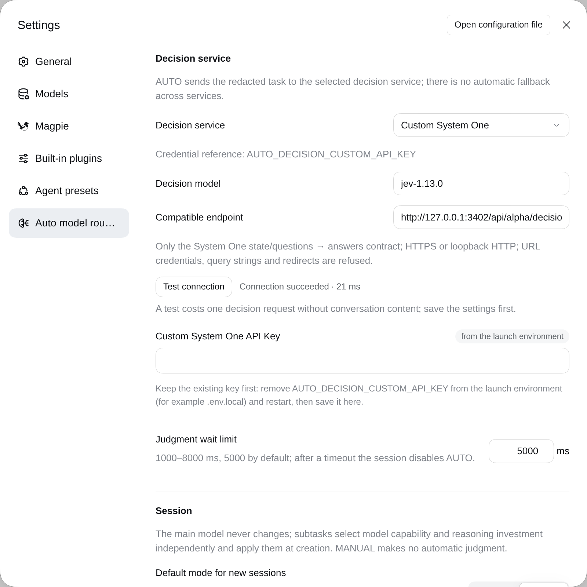

# dsh-auto-model-routing

English · [简体中文](README.zh.md)





*Top: an applied AUTO decision with its effort distribution. Bottom: decision service settings with a successful connection test. Captured from an isolated DSH host with a loopback mock decision service and a loopback mock model provider; endpoint, account and tasks are synthetic.*


<!-- problem -->
**Add AUTO mode to DSH: automatic effort for the main agent, automatic model + effort for sub-agents.** Stop adjusting reasoning investment every turn or choosing a model for every delegated task.

- **Main agent: keep your selected model and adjust reasoning effort per user turn.**
- **Sub-agents: judge capability needs and reasoning investment independently, then select model + effort.** A stronger model does not automatically mean deeper reasoning.
- **Visible decisions, local feedback:** inspect candidate distributions and actual application status, then rate the allocation below a reply.

### Which DSH scenarios does AUTO cover?

| Scenario | AUTO behavior | Current boundary |
|---|---|---|
| Main-agent user turn | Judge effort for each new user turn; keep the main model | Not rejudged at every tool step; model must support the effort |
| Official fresh `subagent` | Select and bind child model + effort before its first request | Ordinary Claude/GPT child calls verified against a live provider; catalog and allowlist apply |
| Official fresh `spawn_teammate` | Bind the new teammate's model + effort using the same policy | Mock-host coverage; real-provider teammate acceptance remains unverified |
| Resume or continue a bound child | Replay its initial allocation without rejudging | Requires the plugin enabled and intact route records |
| Explicit model / effort | Preserve the specified dimension; judge only the other | Both specified: validate without calling Jev |
| Fork, third-party or unbound creation paths | No automatic-allocation guarantee | Unbound children (including fork) pass through untouched; the preview reports fork as unsupported, and AUTO never silently substitutes a route |

This describes official integration paths—not acceptance of every DSH entry point, CLI/TUI interface or third-party plugin. The Web UI is the currently verified interface. MANUAL makes no new judgments. `route_subagent` is a preview, not a required step before dispatch.

### Local feedback → future learning and adjustment

**Available now:** rate a decision-bound reply as appropriate, too high, too low or unknown; change or clear the rating. Feedback and decision snapshots stay on your machine. Submitting feedback does not upload it to the decision service or immediately change routing; AUTO task judgments themselves still use your selected external service.

**Planned direction:** add learning, evaluation and policy adjustment based on local feedback and execution outcomes, so AUTO can better fit your tasks. **Automatic learning and feedback-driven tuning are not implemented yet.** Today's records support later evaluation; they are not evidence of measured quality gains or cost savings.

**Install.** This version line requires DSH `>=0.2.2-rc.1 <0.3.0` (tested with `0.2.2-rc.1`), Web UI, Node.js `>=22.19`.

**Version lines.** DSH 0.2.0–0.2.1 hosts keep using the already published 0.7.x / 0.6.x releases of this plugin. DSH 0.2.2 and later use a new minor release of this plugin (the number is fixed at release time; the published 0.7.0 is not reused). The floor moved to `0.2.2-rc.1` because AUTO now relies on `agent.model.select` and on 0.2.2's per-step selection pinning, neither of which exists in 0.2.0/0.2.1 — see the [Changelog](CHANGELOG.md).

```sh
dsh plugin --profile web add dsh-auto-model-routing
# Or install source (approve the local build when prompted):
dsh plugin --profile web add prgrmrwy/dsh-auto-model-routing
```

Restart DSH and refresh the Web page. In **Settings → Auto model routing**, choose a decision service, save its API key, and use **Test connection** with a fixed public sample. These are English descriptions of the controls; since 0.6.0 the plugin's own labels follow the DSH UI language (Chinese or English). New chats default to **MANUAL**; click the chip to use AUTO. The companion delegation skill is included—no separate skill installation is needed.

## Use

| Where | What you do |
|---|---|
| **AUTO / MANUAL chip**, left of the model picker | Click to switch. Hover for the decision, candidate distribution, certainty, model/effort and application status. |
| **Decision hint** | Shows new decisions briefly; its Settings switch does not hide the hover panel. |
| **Gauge button** below an eligible reply | Mark the allocation appropriate, too high, too low or unknown; change or clear your feedback later. Only replies bound to an applied main decision qualify. |
| **Settings → Auto model routing** | Choose service/model, manage its separate key, test the connection, set defaults/cap/deadline, or expand **View decision strategy** to inspect the actual rubric and model slots. |

### Main model stays fixed; children are selected separately

- **Main chat:** `lower / baseline / higher` moves at most one supported effort step below/at/above the model's verified recommended starting point. The cap defaults to `xhigh`; AUTO never selects `max`. It keeps the main provider/model and applies the effort at the start of every step (the `agent/pre-step`, where DSH 0.2.2 has fixed the step's selection but not yet built the request): it first syncs the effort through official `selectModel`, which also saves global defaults, then writes it into that step's pinned selection, so the first request of the turn already carries it. If the sync fails, or the runtime hands over a frozen selection, a warning is logged and the step keeps the official effort (a frozen selection takes effect from the next step); MANUAL requests pass through unchanged and bound children never write the main selection. This relies on an implementation detail of the runtime and is pinned by `test/runtime-selection.e2e.test.ts`.
- **Registered families only:** AUTO manages a main model only when its family has a registered strategy; `claude-` and `gpt-` ship built in, and the id is matched after any transport prefix. Selecting any other main model — DeepSeek, GLM, Grok, Gemini, Kimi, Qwen, … — switches the session to MANUAL and locks the chip: it shows an outlined info icon, and hovering the whole button explains the support scope with an issue/PR link to the repository. Switching back to a supported model restores a clickable MANUAL chip; AUTO is never re-enabled automatically. Adding a family is a data change, not an engine change: see [custom model families](#custom-model-families).
- **Fresh children:** capability is `bounded / analytical / frontier`; effort is judged separately. Claude slots are Haiku / Sonnet / Opus 5.5; GPT slots are Luna / Sol / Sol. The current catalog, supported efforts and official child allowlist must all permit the route. Routes keep the parent's exact provider and full model ids, including any transport prefix; there is no fallback to another provider.
- **Explicit choices win:** specifying a model or effort leaves only the other dimension to judge. Specifying both skips Jev and validates the route. Missing task scope stops delegation rather than guessing.
- **Official creation binds the route:** fresh `subagent` and fresh `spawn_teammate` paths bind an exact child identity when the child is created: the judgement runs in the child's `agent/created` (awaited before its first message is delivered, cancellable with the creation) and the route is written into the child's own selection, never into global defaults. `agent/request` only verifies it on every attempt, retries included. `route_subagent` is an optional preview—not proof of application and not a user constraint to copy into a subsequent call; a MANUAL root session makes it return `routed: false` without judging or writing state. Fork and unbound creation paths are unsupported; there is no silent substitution.
- **Resume keeps the initial route.** Switching the root to MANUAL stops new judgments; already bound children retain their initial route (a child recorded by 0.2.1 but interrupted before its first request gets its route written on resume, without a new judgement). `applied` means the actual request configuration matched, **not** that the task succeeded. Ordinary Claude/GPT child calls were tested against a live provider; fresh teammate routing and cold resume have mock-host coverage, not real-provider teammate acceptance.

### Choose the decision service

| Service | Endpoint | Default model | Credential reference |
|---|---|---|---|
| OpenRouter (default, preserves existing installations) | `https://openrouter.ai/api/alpha/decisions` | `typesafe/jev-1.13` | `OPENROUTER_API_KEY` |
| TypeSafe | `https://api.typesafe.ai/v1/systemone` | `jev-1.13.0` | `TYPESAFE_API_KEY` |
| Concentrate | `https://api.concentrate.ai/v1/systemone` | `jev-1.13.0` | `CONCENTRATE_API_KEY` |
| Custom System One | Your full endpoint | Editable | `AUTO_DECISION_CUSTOM_API_KEY` |

Preset model menus expose documented versions, not live availability guarantees. Custom services keep an editable model ID and must support `state + questions → answers`; an OpenAI chat-completions endpoint alone is not compatible. Custom endpoints require HTTPS (loopback HTTP is allowed), reject URL credentials/query/fragment and redirects. Only configure endpoints you trust with the dedicated key. TypeSafe and Concentrate have contract/mock coverage; their live authentication and regional availability were not verified here. No service failover occurs automatically.

**Certainty is not the selected probability.** Choice certainty is `(pmax − 1/n) / (1 − 1/n)`: with three candidates, a 70% top probability gives 55% certainty. The panel shows the service's returned certainty and full candidate distribution separately, including returned zeroes; missing values are marked unavailable. Neither number is task success rate.

### Judgement presets

The questions AUTO asks Jev come from a built-in, named and sourced **judgement preset**; pick one under Settings → Auto model routing → Judgement preset. A preset only changes how Jev chooses `lower` / `baseline` / `higher` (and `capability` for subtasks); the effort ladder, the one-step offset, the cap, the never-`max` rule and the sub-model slots stay the same.

| Preset | Depth means | Source |
|---|---|---|
| `reasoning-depth` (default) | reasoning difficulty; the rule file used up to 0.6.6, byte for byte | this project's synthetic check |
| `effort-as-verification` | how much verification, edge-case testing and independent judgement the next work needs; adds a fixed `Execution:` call-path line | Anthropic, [Spending your effort](https://claude.dev/blog/spending-your-effort/) (vendor-internal numbers; GPT use is an unverified extrapolation) |

**Adding your own preset.** Presets are built in, so a new one is a small source change in this package: add `src/presets/<id>/rubric.json` (same labels as the existing presets), append its metadata (title, summary, evidence, sources, `context`) to `PRESETS` in `src/presets/index.ts`, append its hash to the lock table in `test/presets.test.ts`, write `docs/presets/<id>.md`, then `npm test`, build and restart. It shows up in the settings picker and decision hints automatically; the effort ladder, cap and model slots stay out of reach. Step-by-step: [docs/presets](docs/presets/README.md#adding-a-preset).

Published presets never change in place: a new idea becomes a new preset id, so a selected preset keeps judging the same way after an upgrade. Each binding snapshot records which preset made the decision. Details: [docs/presets](docs/presets/README.md). Downgrading to 0.6.6 ignores the `preset` setting, and bindings that carry `snapshot.preset` are skipped by the older reader; the ledger is not rewritten and upgrading again makes them visible.

### Custom model families

Everything AUTO knows about a model family is data in [`src/strategies/`](src/strategies/index.ts): one file per family plus the `BUILTIN_STRATEGIES` list. Adding DeepSeek, Qwen, Gemini or an in-house family means adding a strategy file and registering it; the engine has no family knowledge of its own and provider is never part of a strategy. AUTO also has no gateway-specific code or configuration, so it works on whatever provider the session already uses.

| Field | Meaning and constraints |
|---|---|
| `id` | Unique family id. Child records and feedback snapshots store it and the usage report groups by it, so renaming an id makes those records unreadable (fail closed). |
| `label` | Shown in the chip's lock tooltip and in the Settings strategy panel. |
| `modelPrefixes` | Matched case-insensitively against the main model id after its last `/`, so a gateway's `family/` prefix is not part of the family name. A main model outside every family locks the session to MANUAL. |
| `effortStarts` | Exact bare model id (case-sensitive) → `low`, `medium`, `high` or `xhigh` recommended starting point for the `lower / baseline / higher` offset and the cap. A model without a start uses the provider directory's default effort when that effort is supported too (the panel labels it "catalog default"); otherwise automatic effort is unavailable, so the main request keeps its own configuration and child routing follows its fallback chain. |
| `childModels` | One bare model name per capability slot, `bounded` / `analytical` / `frontier`, with no `/`. A slot resolves only inside the parent's provider, only with the parent's transport prefix, and only when exactly one live catalog entry matches. |

`createRegistry` validates the whole list once, when the plugin loads, and rejects the plugin instead of running with part of a family set: a missing or duplicate `id`; prefixes of different families overlapping case-insensitively; a start other than the four values; the same start key in two families; a missing capability slot; a slot containing `/`; any key outside the five fields above.

To add a family, edit the package source — an ohmydsh checkout or your own fork — copying the shape of [`claude.ts`](src/strategies/claude.ts) or [`codex.ts`](src/strategies/codex.ts) (`deepseek-v5` below is a placeholder for an id your provider catalog really exposes):

```ts
// src/strategies/deepseek.ts
import type { FamilyStrategy } from './types.js'

export const deepseek = {
  id: 'deepseek',
  label: 'DeepSeek',
  modelPrefixes: ['deepseek-'],
  effortStarts: { 'deepseek-v5': 'medium' },
  childModels: { bounded: 'deepseek-v5', analytical: 'deepseek-v5', frontier: 'deepseek-v5' },
} as const satisfies FamilyStrategy
```

Then add it to `BUILTIN_STRATEGIES` in [`src/strategies/index.ts`](src/strategies/index.ts), run `npm test`, `npm run typecheck` and `npm run build`, and install the rebuilt package (`dsh build` in ohmydsh, or update the npm dependency) before restarting DSH and refreshing the page. The Settings strategy panel, the lock tooltip, child routing and the usage report all read this registry, so no other file needs family knowledge; the package test fails if built-in family ids or prefix comparisons are repeated outside `src/strategies/`.

A new family changes which main models AUTO manages and which slot models child tasks may pick. It does not add a provider, transport or fallback: every route keeps the parent's provider and full model id, and is still checked against the live catalog, the four effort levels, the `max` prohibition, the official child allowlist and a captured parent allowlist. Explicit model/effort arguments are preserved or validated, never replaced. Family knowledge is build-time only: there is no Settings field, plugin settings file or hot reload for strategies.

## Good to know

- **Failures are visible.** Main judgment failure disables AUTO with a reason; child judgment/route failure stops dispatch. No local classifier, automatic retry, upgrade or cross-service fallback.
- **MANUAL stops adjustments, not history.** It does not restore an earlier effort. The official current selection remains in control; existing bound children keep their route while the plugin is enabled.
- **Data leaves the machine.** AUTO sends shape-redacted task text (up to 8000 characters) and short previous-turn excerpts to your chosen service. Redaction is best effort, not a guarantee that all secrets are removed. Test Connection sends only a fixed public sample and can incur a small charge.
- **Keys use official DSH credentials**, never plugin configuration. Launch-environment keys take precedence and are read-only. Service changes clear key drafts; save the service before managing its separate key. Changing a custom endpoint does not create a new credential namespace—review the key before trusting a new host.
- **Local state:** configuration is under `$DSH_HOME/plugins/dsh-auto-model-routing/`; mode, child routes and feedback are under `$DSH_HOME/state/auto-model-routing/`. Feedback stores resource metadata, IDs, the strategy family, returned distributions and timestamps—not task/reply text. Request event IDs allow later usage correlation; costs are not fabricated when unavailable. See [feedback and evaluation](docs/feedback-evaluation.md).
- **No automatic learning.** Human allocation feedback is observational. It does not change routing or prove quality/cost benefits. Old messages without decision bindings are not backfilled; old records with missing evaluation fields remain unknown.
- **The interface follows the DSH UI language.** Since 0.6.0 the AUTO chip, status panel, decision hint, reply-bar feedback menu and the Settings section ship English and Chinese dictionaries and render in the active DSH language (`ctx.locale`); before 0.6.0 the copy was Chinese-only. A host without a locale service (or a unit test) falls back to the Chinese reference set, so stored settings and recorded decisions are untouched.
- **Upgrade to 0.5.0:** there is one AUTO strategy and no version setting. Existing sessions keep their stored mode; new chats still default to MANUAL unless configured otherwise. Retired `policy` / `mainEfforts` / `childRoutes` keys in the plugin configuration are ignored, shown as no longer effective in Settings, and removed on the next save. Child decisions and feedback recorded by 0.4.x stay readable. To go back, pin the published `dsh-auto-model-routing@0.4.2` (see [CHANGELOG](CHANGELOG.md) for the data boundary).

## Architecture
<!-- section: architecture -->

The diagram at the top shows the AUTO paths. Main failures disable AUTO; child failures stop dispatch. Explicit model/effort constraints are preserved. MANUAL makes no new judgments and fork is unsupported. Feedback does not automatically alter routing.

Entry: [index.ts](src/index.ts). Enforcement: [policy-host.ts](src/policy-host.ts). Actual rubric: [rubric.json](src/presets/reasoning-depth/rubric.json). Family strategies (supported models, effort starting points, capability slots): [strategies](src/strategies/index.ts); routing: [routing.ts](src/routing.ts). UI: [client](src/client/index.ts). Coverage and limitations (historical records): [development verification](docs/policy-v2-development.md), [host capability report](docs/host-capability-report.md).

## Development

```sh
npm test
npm run typecheck
npm run build
```

Tests use the official AgentLoop with fake LLM streams and mock/loopback Jev responses, not paid model calls. To observe AUTO decisions and their actual token usage, ask the agent to use the `auto-model-routing-report` skill (on demand only; it runs the read-only `lib/usage-report.js`). It is observational, not a savings measurement. Evaluation schema and deduplication rules are in [feedback-evaluation.md](docs/feedback-evaluation.md).

The package builds and loads independently using its declared dependencies, bundled skill and official DSH services; no monorepo checkout or monorepo instruction file is required. External design references are optional background, not runtime inputs. The bundled [delegation skill](skills/subagent-model-routing/SKILL.md) supplies guidance; enforcement belongs to the official host hooks, not the prompt. No measured task-quality or token-savings claim is made.

## Removal
<!-- section: removal -->

```sh
dsh plugin --profile web remove dsh-auto-model-routing
```

Restart DSH and refresh the page. The plugin's skill/tools and request hooks disappear; settings and logs remain. Without the plugin, child replay is no longer enforced and host restoration uses the original creation configuration. In [ohmydsh](https://github.com/prgrmrwy/ohmydsh), disable the local entry and rebuild instead.

## Source, license and contributing

This plugin is developed in [ohmydsh](https://github.com/prgrmrwy/ohmydsh) (`packages/dsh-auto-model-routing`); [this repository](https://github.com/prgrmrwy/dsh-auto-model-routing) is its release mirror, published automatically to [npm](https://www.npmjs.com/package/dsh-auto-model-routing) and [GitHub Releases](https://github.com/prgrmrwy/dsh-auto-model-routing/releases). The [current specification](https://github.com/prgrmrwy/ohmydsh/blob/main/openspec/specs/auto-model-routing/spec.md) lives there too.

[MIT](LICENSE). Issues and pull requests are welcome at [prgrmrwy/dsh-auto-model-routing](https://github.com/prgrmrwy/dsh-auto-model-routing/issues) — including support for model families beyond Claude and GPT.
