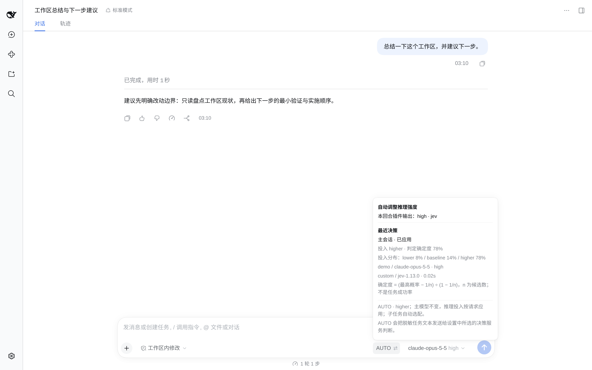
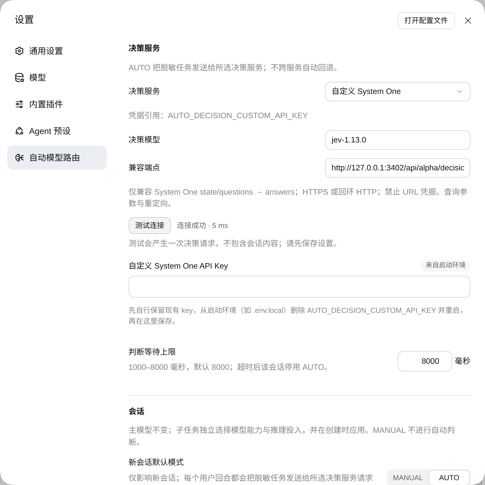

# dsh-auto-model-routing

[English](README.md) · 简体中文





*上：已应用的 AUTO 决策与投入分布；下：决策服务设置与连接测试成功。截图来自隔离 DSH 宿主，使用回环模拟决策服务与回环模拟模型 provider；端点、账号与任务均为合成数据。*


<!-- problem -->
**为 DSH 增加 AUTO 模式：主 Agent 自动调 effort，子 Agent 自动选 model + effort。** 不必每轮手动选择推理投入，也不必为每个子任务手动挑模型。

- **主 Agent：保留你选择的模型，按回合调整推理投入（effort）。**
- **子 Agent：按任务独立判断能力需求与推理投入，选择模型与 effort。** 不是把“更强模型”和“更深推理”捆成一个档位。
- **看得见、能反馈：** 展示决策分布与实际生效状态，在回复下方提交本机分配反馈。

### AUTO 覆盖哪些 DSH 场景？

| 场景 | AUTO 的作用 | 当前边界 |
|---|---|---|
| 主 Agent 用户回合 | 每个新用户回合判断 effort，主模型不换 | 不逐工具步骤重判；模型必须支持相应 effort |
| 官方 fresh `subagent` | 首次请求前选择并绑定子 model + effort | Claude/GPT 普通子调用已在真实模型上验证；受目录和允许列表约束 |
| 官方 fresh `spawn_teammate` | 按同一策略绑定新 teammate 的 model + effort | 已有 mock 宿主覆盖，尚未完成真实模型 teammate 验收 |
| 已绑定子实例恢复或继续执行 | 重用初始路线，不重新分配 | 依赖插件保持启用及路由记录完整 |
| 显式指定 model / effort | 保留已指定维度，仅判断未指定维度 | 两者都指定则只校验，不调用 Jev |
| fork、第三方或未绑定创建路径 | 不承诺自动选配 | 未绑定子实例（含 fork）原样放行；预览工具对 fork 返回不支持，AUTO 不会静默替换成别的路由 |

这里是官方接入路径的覆盖说明，不代表所有 DSH 入口、CLI/TUI 界面或第三方插件都已验收。Web UI 是当前验证入口；MANUAL 不做新判断。`route_subagent` 仅预览，不是必须先调用的派发步骤。

### 本机反馈 → 未来的学习调整

**现在：** 在已绑定决策的回复下评价“合适 / 投入偏高 / 投入不足 / 无法判断”，可修改、撤销。反馈与决策快照保存在本机，不会因点击反馈而上传到决策服务，也不会立即改变路由；AUTO 任务判断本身仍按所选服务外发。

**未来方向：** 增加基于本机反馈与执行结果的学习、评估和策略调整，让 AUTO 更贴合你的任务。**尚未实现自动学习或反馈驱动调参**，目前记录用于后续评估，不承诺已证明的质量提升或成本节省。

**安装**：已验证 DSH `0.2.0-rc.2`、Web UI，Node.js `>=22.19`。

```sh
dsh plugin --profile web add dsh-auto-model-routing
# 或从源码安装（出现提示时批准本地构建）：
dsh plugin --profile web add prgrmrwy/dsh-auto-model-routing
```

重启 DSH 并刷新页面，到**设置 → 自动模型路由**选择决策服务、保存对应 API key，点击**测试连接**发送固定公开样例。新会话缺省 **MANUAL**，点击芯片切换 AUTO。配套委派 skill 已包含，无需单独安装。

## 使用

| 位置 | 操作 |
|---|---|
| **AUTO / MANUAL 芯片**（模型选择器左侧） | 点击切换；悬停查看判断、候选分布、确定度、模型与投入、生效状态 |
| **判档提示** | 短暂显示新决策；关闭设置中的提示开关不会隐藏悬浮面板 |
| 回复下方的**仪表按钮** | 评价分配合适、投入偏高、投入不足或无法判断，支持修改和撤销；仅对绑定已应用主决策的回复显示 |
| **设置 → 自动模型路由** | 选择服务与模型、管理独立 key、测试连接、设置模式/强度上限/等待时间；展开**查看决策策略**查看实际判据与模型槽 |

### 主模型不换，子任务独立选配

- **主会话**：`lower / baseline / higher` 相对于具体模型已验证的推荐起点，在受支持序列降低一档、保持或提高一档。缺省上限 `xhigh`，自动不选 `max`；主 provider/model 不变；通过官方 `selectModel` 同步选定 effort，同时保存全局默认值。同步失败会记录告警，本次请求保留官方原有 effort；MANUAL 请求原样通过，已绑定子会话不写主选择。
- **只管理已注册家族**：主模型的家族有注册策略时 AUTO 才接管；内置 `claude-` 与 `gpt-` 两个家族，id 在去掉 transport 前缀后匹配。切换到其他主模型（DeepSeek、GLM、Grok、Gemini、Kimi、Qwen 等）会自动落为 MANUAL 并锁定芯片：芯片显示描边 info 图标，悬停整个按钮说明支持范围并提供仓库的 issue/PR 链接。切回受支持模型后芯片恢复可点击且保持 MANUAL，不会自动重新启用 AUTO。新增家族属于数据变更而非引擎变更，见[自定义模型家族](#自定义模型家族)。
- **fresh 子任务**：能力需求为 `bounded / analytical / frontier`，推理投入独立判断。Claude 能力槽为 Haiku / Sonnet / Opus 5.5；GPT 为 Luna / Sol / Sol。实际路由必须同时满足当前目录、支持的 effort 和官方子智能体允许列表。路由保留父会话精确 provider 与完整 model ID（含 transport 前缀），不回退到其它 provider。
- **尊重显式选择**：只指定模型或投入时，仅判断另一维；两者都指定则不请求 Jev，只校验路由。缺少任务目标或范围时停止委派，不猜。
- **官方创建绑定路由**：fresh `subagent` 和 fresh `spawn_teammate` 在子任务首次请求前绑定精确身份。`route_subagent` 只是可选预览，不代表已应用，也不能把推荐复制成用户约束；根会话为 MANUAL 时它直接返回 `routed: false`，不判断、不写状态。fork 和未绑定创建路径暂不支持，不静默替换。
- **恢复保持初始路线**：根会话改为 MANUAL 后停止新判断，已有绑定子实例维持原路线。`applied` 只证明实际请求配置匹配，**不代表任务成功**。Claude/GPT 普通子调用已在真实模型上验证；fresh teammate 路由及冷恢复有 mock 宿主覆盖，不等于真实模型 teammate 已验收。

### 选择决策服务

| 服务 | 接口 | 缺省模型 | 凭据引用 |
|---|---|---|---|
| OpenRouter（默认，兼容已有安装） | `https://openrouter.ai/api/alpha/decisions` | `typesafe/jev-1.13` | `OPENROUTER_API_KEY` |
| TypeSafe 官方 | `https://api.typesafe.ai/v1/systemone` | `jev-1.13.0` | `TYPESAFE_API_KEY` |
| Concentrate | `https://api.concentrate.ai/v1/systemone` | `jev-1.13.0` | `CONCENTRATE_API_KEY` |
| 自定义 System One | 完整接口地址 | 可编辑 | `AUTO_DECISION_CUSTOM_API_KEY` |

预置模型菜单列出文档确认的版本，不保证实时可用。自定义服务可填写自己的模型 ID，但必须兼容 `state + questions → answers`；只有 OpenAI chat-completions 接口并不兼容。自定义端点限 HTTPS（回环可 HTTP），禁止 URL 凭据、查询参数、片段及重定向。只配置你信任且适合使用该专用 key 的地址。TypeSafe、Concentrate 目前有协议/mock 覆盖，未在本次验证其真实凭据与地区可用性。失败不自动切换服务。

**判定确定度不等于选中概率**：Choice 公式为 `(pmax − 1/n) / (1 − 1/n)`，三个候选中最高概率 70% 对应确定度 55%。面板分别显示服务返回的确定度和完整分布，保留返回的 0%，缺值标未提供。两者都不是任务成功率。

### 自定义模型家族

AUTO 关于一个模型家族的全部知识都是 [`src/strategies/`](src/strategies/index.ts) 中的数据：每个家族一个文件，加一张 `BUILTIN_STRATEGIES` 列表。接入 DeepSeek、Qwen、Gemini 或自研家族，就是新增一个策略文件并注册；引擎本身不认识任何家族，provider 也从不写进策略。AUTO 也没有任何网关专属代码或配置，会话当前使用哪个 provider 就在哪个 provider 上工作。

| 字段 | 含义与约束 |
|---|---|
| `id` | 家族 id，全局唯一。子路由记录与反馈快照都会保存它，用量报告也按它分组，改名会让这些旧记录读不出来（fail closed）。 |
| `label` | 显示在芯片锁定提示与设置页策略面板。 |
| `modelPrefixes` | 与主模型 id 最后一个 `/` 之后的部分做大小写不敏感的前缀匹配，网关的 `family/` 前缀不算家族名。不属于任何家族的主模型会把会话锁为 MANUAL。 |
| `effortStarts` | 精确裸模型 id（区分大小写）→ `low`、`medium`、`high` 或 `xhigh` 推荐起点，供 `lower / baseline / higher` 偏移与上限计算。没有起点的模型，在该 effort 也受支持时改用目录默认 effort（面板标「目录默认」）；两者都不可验证时自动 effort 不可用：主请求保持自身配置，子任务路由走退化链。 |
| `childModels` | 每个能力槽一个裸模型名，`bounded` / `analytical` / `frontier`，不能含 `/`。只有位于父会话 provider 内、与父模型 transport 前缀相同、且目录中恰好匹配到一条时，槽位才生效。 |

`createRegistry` 在插件加载时一次性校验整张列表，任何冲突都会让插件加载失败、不会以部分策略运行：`id` 缺失或重复；不同家族的 `modelPrefixes` 忽略大小写后互为前缀；起点不属于四个取值；同一模型起点键出现在两个家族；缺少某个能力槽；槽位含 `/`；出现上述五个字段以外的键。

新增家族需要改包源码（ohmydsh 检出或你自己的 fork），照 [`claude.ts`](src/strategies/claude.ts) 或 [`codex.ts`](src/strategies/codex.ts) 的形状写文件（下面的 `deepseek-v5` 只是占位，须换成 provider 目录真实存在的 id）：

```ts
// src/strategies/deepseek.ts
import type { FamilyStrategy } from './types.js'

export const deepseek = {
  id: 'deepseek',
  label: 'DeepSeek',
  modelPrefixes: ['deepseek-'],
  effortStarts: { 'deepseek-v5': 'medium' },
  childModels: { bounded: 'deepseek-v5', analytical: 'deepseek-v5', frontier: 'deepseek-v5' },
} as const satisfies FamilyStrategy
```

再把 `deepseek` 加进 [`src/strategies/index.ts`](src/strategies/index.ts) 的 `BUILTIN_STRATEGIES`，运行 `npm test`、`npm run typecheck`、`npm run build`，装回重建后的包（ohmydsh 用 `dsh build`，或更新 npm 依赖），重启 DSH 并刷新页面。设置页策略面板、芯片锁定提示、子任务路由与用量报告都读这张注册表，因此其它文件不需要任何家族知识；若在 `src/strategies/` 之外重复内置家族 id 或前缀判断，包内测试会失败。

新家族改变的是「AUTO 管哪些主模型」和「子任务可以挑哪些槽位模型」，不会新增 provider、transport 或回退路径：所有路由仍保持父会话 provider 与完整 model id，并且照旧逐条通过实时目录、四档 effort、禁用 `max`、官方子智能体允许列表与父会话 captured allowlist 校验；显式 model/effort 只保留或校验，绝不替换。家族知识只在构建期生效：设置页没有对应输入项，插件也没有策略文件或热加载。

## 须知

- **失败可见**：主判断失败会停用 AUTO 并显示原因，子判断或路由失败则停止派发。没有本地分类器、自动重试、自动升级或跨服务降级。
- **MANUAL 停止调整，不复原历史值**：使用官方当前选择；只要插件启用，已绑定子任务仍保留原路线。
- **任务会外发**：AUTO 将按形态脱敏的任务文本（最多 8000 字符）及上一轮少量片段发送给所选服务。脱敏尽力而为，不保证去除全部秘密。测试连接只发送固定公开样例，可能产生少量费用。
- **key 经官方 DSH 凭据服务保存**，不写入插件配置。启动环境 key 优先且只读；切换服务清空 key 草稿，先保存服务再管理新 key。修改自定义端点不会产生新凭据空间，换地址前请确认专用 key 的信任边界。
- **本地状态**：配置在 `$DSH_HOME/plugins/dsh-auto-model-routing/`，模式、子路由及反馈在 `$DSH_HOME/state/auto-model-routing/`。反馈只保存资源元数据、身份、策略家族、返回分布及时间，不保存任务或回复正文。请求事件序号供后续关联用量，缺失成本不会编造。见[反馈评估说明](docs/feedback-evaluation.md)。
- **不自动学习**：人工反馈仅作观察，不改变路由，也不能直接证明质量提升或节省。无决策绑定的旧消息不回填，旧记录缺少的评估字段保持未知。
- **界面跟随 DSH 语言**：0.6.0 起 AUTO 切换、状态面板、决策提示、回复反馈菜单与设置页带中英文字典，按当前 DSH 界面语言渲染（`ctx.locale`）；0.6.0 之前文案只有中文。宿主没有 locale 服务（或单测环境）时回退到中文参考集，已保存设置与已记录决策不受影响。
- **升级到 0.5.0**：只有一套 AUTO 策略，没有版本设置。已有会话保留原模式；新会话缺省仍为 MANUAL，除非你改过设置。插件配置中残留的 `policy`、`mainEfforts`、`childRoutes` 会被忽略，设置页提示不再生效，下次保存时移除。0.4.x 记录的子任务决策与反馈仍可读取。如需退回，固定已发布的 `dsh-auto-model-routing@0.4.2`（数据边界见 [CHANGELOG](CHANGELOG.md)）。

## 架构
<!-- section: architecture -->

顶部的架构图为 AUTO 路径。主判断失败停用 AUTO，子失败停止派发；保留显式 model/effort。MANUAL 不做新判断，fork 暂不支持。反馈不会自动改变路由。

入口：[index.ts](src/index.ts)。执行接入：[policy-host.ts](src/policy-host.ts)。实际判据：[rubric.json](src/rubric.json)。家族策略（支持的模型、effort 起点、能力槽）：[strategies](src/strategies/index.ts)；路由计算：[routing.ts](src/routing.ts)。界面：[client](src/client/index.ts)。覆盖边界（历史记录）：[开发验证](docs/policy-v2-development.md)、[宿主能力核验](docs/host-capability-report.md)。

## 开发验证

```sh
npm test
npm run typecheck
npm run build
```

测试使用官方 AgentLoop、假 LLM 流和 mock/回环 Jev，不产生真实模型费用。如需观察 AUTO 决策及实际 token 用量，请明确让 agent 使用 `auto-model-routing-report` skill（仅按需调用，运行只读的 `lib/usage-report.js`）；它是观察统计，不衡量节省；新数据结构与去重口径见[feedback-evaluation.md](docs/feedback-evaluation.md)。

插件使用自身声明的依赖、包内 skill 和官方 DSH 服务即可独立构建与加载，不要求检出主仓，也不要求安装主仓环境指令。外部设计链接仅供背景阅读，不是运行输入。包内[委派 skill](skills/subagent-model-routing/SKILL.md)提供指引，执行保障来自官方宿主钩子，而不是提示词。暂无完整任务质量或 token 节省的量化结论。

## 移除
<!-- section: removal -->

```sh
dsh plugin --profile web remove dsh-auto-model-routing
```

重启 DSH 并刷新页面。插件的 skill、工具和请求钩子撤销，配置与日志保留。关闭插件后不再执行子路由恢复，宿主使用原始创建配置。在 [ohmydsh](https://github.com/prgrmrwy/ohmydsh) 中则禁用 local 条目并重新构建。

## 来源、许可与参与

本插件在 [ohmydsh](https://github.com/prgrmrwy/ohmydsh)（`packages/dsh-auto-model-routing`）中持续开发，[本仓库](https://github.com/prgrmrwy/dsh-auto-model-routing)是发布镜像，自动发布到 [npm](https://www.npmjs.com/package/dsh-auto-model-routing) 与 [GitHub Releases](https://github.com/prgrmrwy/dsh-auto-model-routing/releases)。[当前规范](https://github.com/prgrmrwy/ohmydsh/blob/main/openspec/specs/auto-model-routing/spec.md)也在主仓维护。

采用 [MIT](LICENSE) 许可。欢迎到 [prgrmrwy/dsh-auto-model-routing](https://github.com/prgrmrwy/dsh-auto-model-routing/issues) 提 issue 和 PR，包括支持 Claude、GPT 以外的模型家族。
