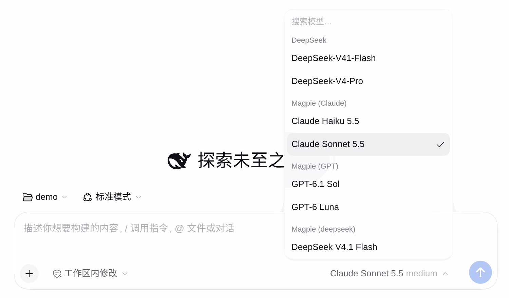
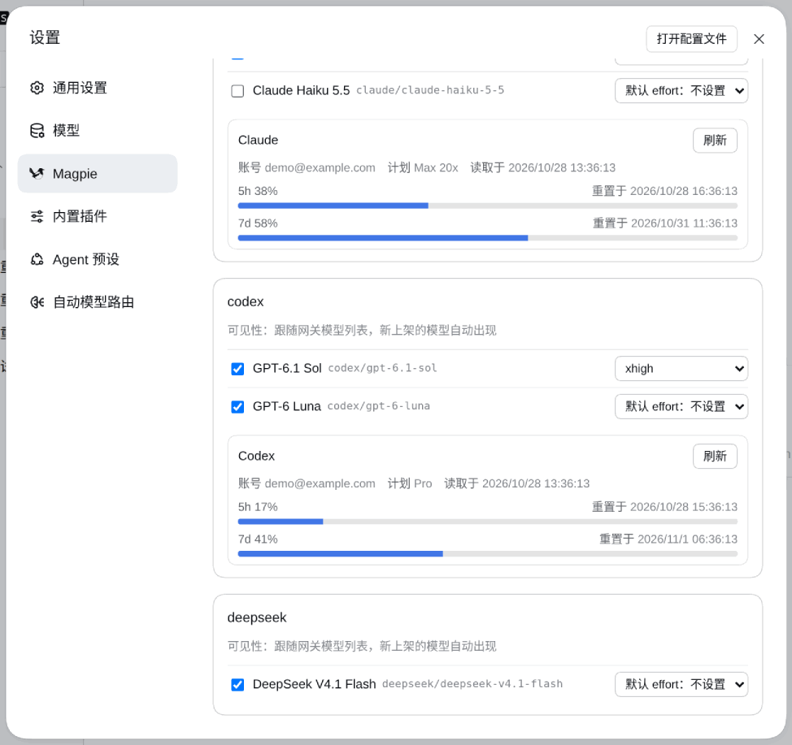

# dsh-magpie-connector

English · [简体中文](README.zh.md)

<p align="center">
  
  
</p>

*Left: model picker grouped by upstream provider. Right: Settings → Magpie — the connection line, then per-provider model visibility, default effort and usage cards. Captured from an isolated DSH host with a local mock Magpie gateway; models and accounts are synthetic.*


<!-- problem -->
**Connect a self-hosted Magpie gateway to DeepSeek Harness with one provider route per upstream owner: models grouped by upstream provider on stock DSH, read-only usage cards, and a per-session fast mode.** Magpie keeps managing logins, accounts, routing and provider egress; this plugin adds the DSH side.

### What you get

| Capability | What it does |
|---|---|
| **Gateway lines** (basic) | Each line has its own URL and gateway key. The model catalog comes from the gateway's `GET /models`; Responses-capable models use Responses, everything else uses Chat Completions. Text, tool round trips, images, usage, cancellation and DSH-managed retries go through. |
| **Check a line before saving** (0.4.0) | Every line card has “Check line”: one real `GET /models` with that card's address, access mode and key (empty credentials fall back to the line's saved values), rendered as a read-only snapshot — result kind, latency, model count and, when the host has a cached catalog with a sync time, the model ids extra to or missing from that cache. It never changes the active line, writes credentials/settings, syncs the catalog or registers a route; the diff is against the *cached* catalog, so it never claims to match the current line. |
| **Automatic multi-line failover** (signature) | Empty on first install; normally one line; add backup lines and let the order decide priority. Before every gateway operation the plugin picks the first reachable complete line with a ≤600ms TCP probe (10s positive / 15s negative in-memory cache, no background polling), so home uses the LAN while outside falls back to the public endpoint. Switching lines carries the catalog over (no flash), clears usage cards and re-syncs the new line; single-line users keep 0.1.x behavior. |
| **Grouped by upstream provider** (signature) | Works on stock DSH, no Host extension needed: the plugin registers one real provider route per gateway `owned_by` (`dsh-magpie-connector-claude`, `-codex`, `-opencode-go`, …; missing or invalid ownership goes to `-other`), so the official model picker shows `Magpie (Claude)`, `Magpie (Codex)`, `Magpie (Opencode-go)`, `Magpie (Other)` groups. Settings and usage cards use the same grouping, and a provider that only appears in usage is never dropped. |
| **Line panel and latency** | Configured lines start collapsed; click a row header to edit it, and reorder/delete are always-visible DSH product-icon buttons with tooltips. Opening Settings measures every saved line with a parseable address once (parallel TCP connect time, ≤600ms per line, no HTTP, no credentials) and shows a 4-bar signal plus milliseconds; timeouts show a timeout reading and failures or older hosts degrade to a dash. Display-only: it never affects automatic line selection, is not persisted, and never polls. |
| **Per-line Cloudflare Access** | Each line independently chooses Direct or Cloudflare Access. Access-enabled line requests carry the service token pair plus the bearer key; the token is never sent to a plain-HTTP line. |
| **Read-only usage cards** | Each upstream account shows plan, expiry, window readings and Codex reset credits when the gateway provides them. Cards are read once when settings open and only re-read when you press **Refresh** on that card; bars turn orange above 70% and red at 90%. |
| **Model visibility and default effort** | Per provider, leave visibility untouched to follow the gateway catalog, or save an explicit allowlist so new models stay hidden. Per model, save a default reasoning effort; DSH applies it on the next request. |
| **Per-session fast mode** | Models advertising the `priority` service tier get a standard/fast switch next to the composer. The choice is per session and in host memory only; it adds `service_tier: "priority"` to requests. |

### Install

```sh
dsh plugin --profile web add dsh-magpie-connector
```

Restart DSH and refresh the Web page. Inside [ohmydsh](https://github.com/prgrmrwy/ohmydsh) you can instead enable the local `dsh-magpie-connector` manifest entry and rebuild. Tested with DSH `0.2.0-rc.2`, Web UI, Node.js `>=22.19`.

> **0.3.0 BREAKING upgrade**: the single `dsh-magpie-connector` route is retired. Sessions and the default model saved on it no longer resolve; pick the model again from a `Magpie (…)` group. Routes that depend on the exact route id elsewhere (e.g. subagent routing, egress allowlists) must list the new `dsh-magpie-connector-<owner>` ids.

### Configure

Open **Settings → Magpie**.

1. In **line 1**, enter the gateway API URL **including `/v1`**, for example `http://192.168.1.20:3425/v1`, and that line's gateway key. The line list, addresses, visibility and default efforts live at `$DSH_HOME/plugins/dsh-magpie-connector/settings.json` — keys and Access values are never written there or returned by the settings API.
2. For multiple ingresses press **Add backup line**; each line has its own address and key. Use the move-up/move-down buttons to change priority (number 1 wins). Saving keeps only the active line expanded; the 4×4 green marker after its number shows the current line, and the info icon explains priority and automatic fallback.
3. Inside each line's **Advanced connection** choose Direct or Cloudflare Access. LAN and Tailscale are Direct; Cloudflare Access requires an HTTPS line and switching back to Direct clears that line's two Access credentials on save. Cloudflare Free/Pro returns 524 when the origin sends nothing for 100 seconds.
4. Saving synchronizes the catalog; **Refresh model list** synchronizes again, and there is no catalog polling.

> **0.2.0 BREAKING upgrade**: settings are now a single `lines[]` format. A legacy single-address `settings.json` (top-level `baseUrl`) and the legacy fixed credential refs (`MAGPIE_API_KEY` / `MAGPIE_ACCESS_*`) are **not read or migrated**; re-add your lines and enter each line's key/Access in Settings. Model visibility and default efforts are preserved; old credential records can be deleted manually in DSH credentials. Back up `settings.json` and the old refs first if you want to keep a rollback path.

Need another method — custom headers, mTLS, another zero-trust gateway? **Issues and pull requests are welcome**; describe your deployment and the gateway version.

### Where things happen

| Where | What you do |
|---|---|
| **Model picker** | Search across group headings, model names and full ids. Each group is a real route `dsh-magpie-connector-<owner>`; model ids stay the gateway's full ids, and visibility keys and default effort are unchanged. |
| **Model menu groups** | `owned_by` (lower-cased; 1–48 chars of `a-z0-9._-`) picks the route and the label `Magpie (<Owner>)` with the first letter capitalised. Missing or invalid ownership goes to `Magpie (Other)` instead of guessing from the model name. Owners seen once are remembered in `settings.json` `knownOwners` (max 32) so their routes exist right after a restart; the models appear once the first catalog sync finishes. An owner that disappears keeps its (empty, hidden) route. Clearing `knownOwners` by hand invalidates selections saved on the removed routes. If route registration fails at start-up (another plugin owns the id), Settings shows the error and DSH must be restarted after resolving it. |
| **Composer speed control** | Shows only for the current model when the gateway advertises the `priority` tier (on current Magpie: the Codex/GPT models), and updates as soon as the selection changes. Hover the model menu to see effort; the official picker shows one effort value. |
| **Settings → Magpie** | Connection, advanced connection mode, per-provider model sections with visibility checkboxes and default effort selects, plus the usage cards for that provider; each line card also carries the read-only “Check line” snapshot and an “unconfigured” label, and the save result states the resulting active line. |
| **Usage card refresh** | Each card has its own **Refresh**, which asks Magpie to re-read that one account. A cold gateway may return no cards at all; the connection panel then offers **Fetch models and usage**, which first re-synchronizes the catalog and then asks Magpie to read every account once. A restricted held key cannot initialize an empty cache — ask the Magpie administrator to read usage first. |

### Behavior worth knowing

- **Failed requests are retried by DSH, not replayed by the plugin.** The adapter declares the same `llm-retry` policy as `dsh-plugin-subscriptions` (10 attempts, exponential backoff from 1s to 60s, ±20% jitter, honoring `Retry-After`). `TIMEOUT`, `TRANSPORT`, `SERVER`, `RATE_LIMIT` and `EMPTY_RESPONSE` are retryable; 401/403, exhausted quota, context overflow and other 4xx are not.
- **The default output budget reserves room for compaction.** The gateway's `max_output_tokens` is the model's capacity, not the per-request default. The default budget handed to DSH is `min(capacity, max(1, window/4, window/2 − 65536))`, leaving context space for DSH compaction; an explicit `maxTokens` is unaffected. Models with a window below 104,026 tokens follow the same formula but are not guaranteed to pass DSH's compaction checks.
- **Only silence ends a stream.** Headers, SSE events and heartbeats all count as liveness; 300 seconds without any data ends the request with `TIMEOUT` (message contains `MAGPIE_STREAM_TIMEOUT`). Long reasoning survives as long as the gateway keeps the stream alive.
- **Connection changes do not abort work.** A new address or key immediately hides the old catalog and cards, but generations already prepared or running finish with their captured address and key. User cancellation and plugin disposal still stop them.
- **The transport is deliberately narrow.** Host requests go through a private `undici` dispatcher straight to the configured gateway, never through a global proxy dispatcher. Redirects are rejected; only `GET /models`, `POST /responses`, `POST /chat/completions`, `GET /magpie/quotas/cards` and `POST /magpie/quotas/refresh` are allowed; Magpie GUI `/api/*` management endpoints are never called. Provider egress proxies belong in Magpie.
- **Not supported:** `stop` sequences fail before any network access (`MAGPIE_STOP_UNSUPPORTED`) because Magpie cannot preserve them across every upstream translation. Usage cards and Codex reset credits are display-only; the plugin never calls account-management or reset endpoints.
- **Secrets stay out of responses and logs.** Gateway-reflected text is redacted with the current key before it can reach the settings API or logs. Files are written `0600`; the settings API reports only `configured` / `writable`.
- **The interface follows the DSH UI language.** Since 0.5.0 the settings page and the speed menu ship English and Chinese dictionaries and render in the active DSH language (`ctx.locale`); before 0.5.0 the copy was Chinese-only. A host without a locale service (or a unit test) falls back to the Chinese reference set, so stored settings and behaviour are untouched.

### Code map

Entry: [index.ts](src/index.ts). Adapter and request/stream mapping: [adapter.ts](src/host/adapter.ts). Routes: [routes.ts](src/host/routes.ts). Transport allowlist: [transport.ts](src/host/transport.ts). Settings page: [SettingsPage.ts](src/client/SettingsPage.ts). The diagram source, with credential-free repository evidence: [architecture.en.json](docs/architecture.en.json).

### Development

In a standalone checkout of this repository:

```sh
npm install
npm run typecheck
npm test
npm run build
```

Inside the ohmydsh monorepo, install once at the root and add `--workspace=dsh-magpie-connector` to the last three commands. Tests use local mock gateways and the real wire library; no real key is required. Build output is not committed. Both `prepare` and `prepack` build the package.

## Removal
<!-- section: removal -->

```sh
dsh plugin --profile web remove dsh-magpie-connector
```

Restart DSH and refresh the page. Disposal releases registrations, timers and connections; it does not remove credentials or settings. To erase data, delete each line's `MAGPIE_LINE_<ID>_*` refs (plus any pre-0.2.0 `MAGPIE_API_KEY` / `MAGPIE_ACCESS_*` leftovers) through DSH credentials management and remove the plugin settings file after locating it from the installed plugin's data directory. Do not remove a credential if another integration still uses it.

Inside [ohmydsh](https://github.com/prgrmrwy/ohmydsh), set the manifest entry to `enabled: false` and rebuild instead.

## Source, license and contributing

This plugin is developed in [ohmydsh](https://github.com/prgrmrwy/ohmydsh) (`packages/dsh-magpie-connector`); [this repository](https://github.com/prgrmrwy/dsh-magpie-connector) is its release mirror, published automatically to [npm](https://www.npmjs.com/package/dsh-magpie-connector) and [GitHub Releases](https://github.com/prgrmrwy/dsh-magpie-connector/releases). Current behavior is specified in [`openspec/specs/dsh-magpie-connector`](https://github.com/prgrmrwy/ohmydsh/blob/main/openspec/specs/dsh-magpie-connector/spec.md).

[MIT](LICENSE). `@earendil-works/pi-ai` and `undici` are separate MIT-licensed dependencies; the bird artwork follows the notice in [THIRD-PARTY-NOTICES](THIRD-PARTY-NOTICES). Issues and pull requests are welcome at [prgrmrwy/dsh-magpie-connector](https://github.com/prgrmrwy/dsh-magpie-connector/issues).
