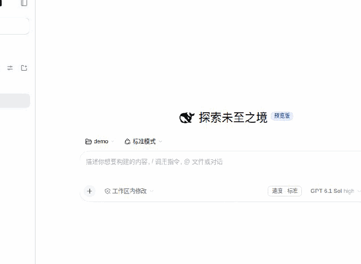
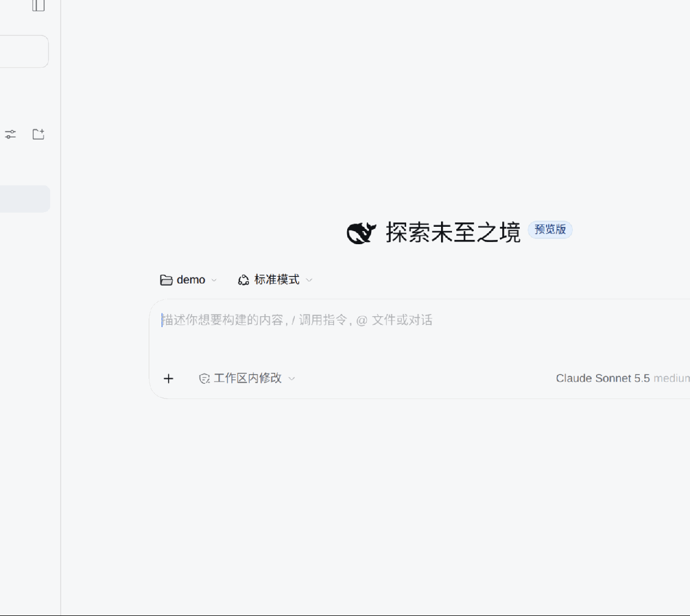

# dsh-magpie-connector

English · [简体中文](README.zh.md)

<p align="center">
  
  
</p>

*Left: model picker. Right: Settings → Magpie. Recorded from an isolated DSH host with a local mock Magpie gateway; models and accounts are synthetic.*

[Repository](https://github.com/prgrmrwy/dsh-magpie-connector) · [Releases](https://github.com/prgrmrwy/dsh-magpie-connector/releases) · [npm](https://www.npmjs.com/package/dsh-magpie-connector)

<!-- problem -->
**Connect a self-hosted Magpie gateway to DeepSeek Harness as one provider route: models grouped by their upstream provider, read-only usage cards, and a per-session fast mode.** Magpie keeps managing logins, accounts, routing and provider egress; this plugin adds the DSH side.

### What you get

| Capability | What it does |
|---|---|
| **Gateway direct connection** (basic) | One gateway URL and one key. The model catalog comes from the gateway's `GET /models`; Responses-capable models use Responses, everything else uses Chat Completions. Text, tool round trips, images, usage, cancellation and DSH-managed retries go through. |
| **Grouped by upstream provider** (signature) | The model picker shows `Magpie (Claude)`, `Magpie (GPT)` and `Magpie (<other owner>)` headings while the real route stays one `dsh-magpie-connector`. Settings and usage cards use the same grouping, and a provider that only appears in usage is never dropped. |
| **Cloudflare Access remote connection** | For a gateway behind Cloudflare Tunnel + Access, save the service token's Client ID and Secret. Every gateway request then also carries `CF-Access-Client-Id` / `CF-Access-Client-Secret`; HTTPS only. |
| **Read-only usage cards** | Each upstream account shows plan, expiry, window readings and Codex reset credits when the gateway provides them. Cards are read once when settings open and only re-read when you press **Refresh** on that card; bars turn orange above 70% and red at 90%. |
| **Model visibility and default effort** | Per provider, leave visibility untouched to follow the gateway catalog, or save an explicit allowlist so new models stay hidden. Per model, save a default reasoning effort; DSH applies it on the next request. |
| **Per-session fast mode** | Models advertising the `priority` service tier get a standard/fast switch next to the composer. The choice is per session and in host memory only; it adds `service_tier: "priority"` to requests. |

### Install

```sh
dsh plugin --profile web add dsh-magpie-connector
```

Restart DSH and refresh the Web page. Inside [ohmydsh](https://github.com/prgrmrwy/ohmydsh) you can instead enable the local `dsh-magpie-connector` manifest entry and rebuild. Tested with DSH `0.2.0-rc.2`, Web UI, Node.js `>=22.19`.

The model picker headings need the managed five-package Host extension that ohmydsh's Pet compatibility layer builds for the reviewed `0.2.0-rc.2` pin. Stock rc.2 still uses the route and generation normally, with a flat provider list.

### Configure

Open **Settings → Magpie**.

1. Enter the gateway API URL **including `/v1`**, for example `http://192.168.1.20:3425/v1`.
2. Enter the gateway key. It is stored through DSH credentials as `MAGPIE_API_KEY`; a key supplied by the launch environment is read-only here. Address, visibility and default efforts live at `$DSH_HOME/plugins/dsh-magpie-connector/settings.json` — the key is never written there or returned by the settings API.
3. Save. Saving the connection synchronizes the catalog; **Refresh model list** synchronizes again, and there is no catalog polling.

**Advanced connection** (expanded by default) chooses how the gateway is reached:

- **Direct** (default) — the gateway URL is reachable as-is. LAN and Tailscale both count: after joining the tailnet use `http://<host>.<tailnet>.ts.net:3425/v1` or the subnet-routed address; nothing else is configured in the plugin.
- **Cloudflare Access** — for Cloudflare Tunnel + Access when the client cannot run a VPN. Enter the Access service token pair; every request carries both headers plus the bearer key. Saving after switching back to Direct clears the saved Access credentials. Cloudflare Free/Pro returns 524 when the origin sends nothing for 100 seconds.

Need another method — custom headers, mTLS, another zero-trust gateway? **Issues and pull requests are welcome**; describe your deployment and the gateway version.

### Where things happen

| Where | What you do |
|---|---|
| **Model picker** | Search across group headings, model names and full ids. Headings come from the gateway's `owned_by`; the route behind every item is still `dsh-magpie-connector`, so model ids, visibility keys and default effort do not change. |
| **Model menu groups** | A model with a non-empty `owned_by` appears under `Magpie (<owner>)`; `claude` and `codex` are shown as Claude and GPT. Missing ownership falls back to `Magpie (Other)` instead of guessing from the model name. |
| **Composer speed control** | Shows only for the current model when the gateway advertises the `priority` tier (on current Magpie: the Codex/GPT models), and updates as soon as the selection changes. Hover the model menu to see effort; the official picker shows one effort value. |
| **Settings → Magpie** | Connection, advanced connection mode, per-provider model sections with visibility checkboxes and default effort selects, plus the usage cards for that provider. |
| **Usage card refresh** | Each card has its own **Refresh**, which asks Magpie to re-read that one account. A cold gateway may return no cards at all; the connection panel then offers **Fetch models and usage**, which first re-synchronizes the catalog and then asks Magpie to read every account once. A restricted held key cannot initialize an empty cache — ask the Magpie administrator to read usage first. |

### Behavior worth knowing

- **Failed requests are retried by DSH, not replayed by the plugin.** The adapter declares the same `llm-retry` policy as `dsh-plugin-subscriptions` (10 attempts, exponential backoff from 1s to 60s, ±20% jitter, honoring `Retry-After`). `TIMEOUT`, `TRANSPORT`, `SERVER`, `RATE_LIMIT` and `EMPTY_RESPONSE` are retryable; 401/403, exhausted quota, context overflow and other 4xx are not.
- **Only silence ends a stream.** Headers, SSE events and heartbeats all count as liveness; 300 seconds without any data ends the request with `TIMEOUT` (message contains `MAGPIE_STREAM_TIMEOUT`). Long reasoning survives as long as the gateway keeps the stream alive.
- **Connection changes do not abort work.** A new address or key immediately hides the old catalog and cards, but generations already prepared or running finish with their captured address and key. User cancellation and plugin disposal still stop them.
- **The transport is deliberately narrow.** Host requests go through a private `undici` dispatcher straight to the configured gateway, never through a global proxy dispatcher. Redirects are rejected; only `GET /models`, `POST /responses`, `POST /chat/completions`, `GET /magpie/quotas/cards` and `POST /magpie/quotas/refresh` are allowed; Magpie GUI `/api/*` management endpoints are never called. Provider egress proxies belong in Magpie.
- **Not supported:** `stop` sequences fail before any network access (`MAGPIE_STOP_UNSUPPORTED`) because Magpie cannot preserve them across every upstream translation. Usage cards and Codex reset credits are display-only; the plugin never calls account-management or reset endpoints.
- **Secrets stay out of responses and logs.** Gateway-reflected text is redacted with the current key before it can reach the settings API or logs. Files are written `0600`; the settings API reports only `configured` / `writable`.

### Architecture


Entry: [index.ts](src/index.ts). Adapter and request/stream mapping: [adapter.ts](src/host/adapter.ts). Routes: [routes.ts](src/host/routes.ts). Transport allowlist: [transport.ts](src/host/transport.ts). Settings page: [SettingsPage.ts](src/client/SettingsPage.ts). The diagram source, with credential-free repository evidence: [architecture.en.json](docs/architecture.en.json).

### Migrating from the old plugin id

The plugin was previously named `dsh-magpie`. The route, settings directory and plugin id are now `dsh-magpie-connector`:

- `MAGPIE_API_KEY` and the optional Access credentials keep their names, so the key keeps working.
- On first start the plugin reads `$DSH_HOME/plugins/dsh-magpie/settings.json` once if the new file does not exist. The old file is neither rewritten nor deleted.
- Sessions that saved the old `dsh-magpie` route need a manual model re-selection; the old route is no longer registered.
- AUTO and the egress-guard exemption list use the new route id.

### Development

```sh
npm install
npm test --workspace=dsh-magpie-connector
npm run typecheck --workspace=dsh-magpie-connector
npm run build --workspace=dsh-magpie-connector
```

Tests use local mock gateways and the real wire library; no real key is required. Build output is not committed. Both `prepare` and `prepack` build the package.

## Removal
<!-- section: removal -->

```sh
dsh plugin --profile web remove dsh-magpie-connector
```

Restart DSH and refresh the page. Disposal releases registrations, timers and connections; it does not remove credentials or settings. To erase data, delete the `MAGPIE_API_KEY` credential through DSH credentials management and remove the plugin settings file after locating it from the installed plugin's data directory. Do not remove the credential if another integration still uses it.

Inside [ohmydsh](https://github.com/prgrmrwy/ohmydsh), set the manifest entry to `enabled: false` and rebuild instead.

## License

MIT. `@earendil-works/pi-ai` and `undici` are separate MIT-licensed dependencies; the bird artwork follows the notice in [THIRD-PARTY-NOTICES](THIRD-PARTY-NOTICES).
