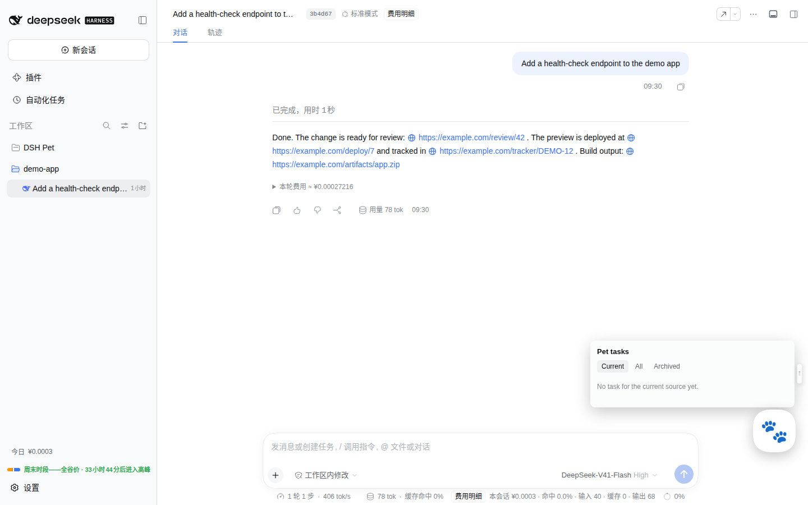
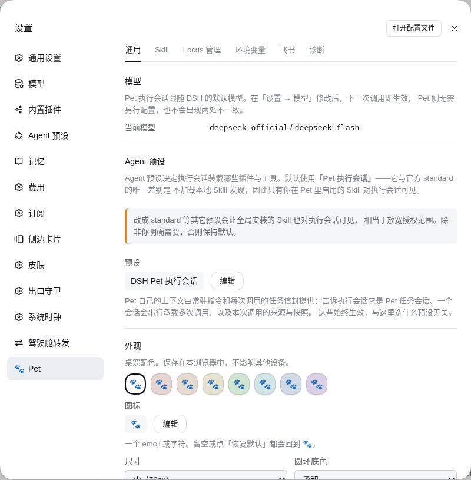

# dsh-pet

English · [简体中文](README.zh.md)





<!-- problem -->
Routine chores such as cleaning up a worktree or answering a teammate's question from chat usually mean interrupting the session you are developing in, or pasting context into a new one by hand. Pet is a small floating companion in the DSH web UI that runs those chores for you in a separate session, working from a frozen copy of what you were looking at, so your development session stays clean and every action stays traceable.

**What you get**

- **Quick actions without leaving your work.** A draggable mascot with a wheel of shortcuts. Each one runs an ordinary DSH Skill that you import yourself, in its own executor session, against an immutable snapshot of the session or workspace you were in.
- **A traceable record.** Quick-action requests have Tasks, Invocations and Runs in the task panel; Lark requests have their own per-entry Delivery queue. Quick actions do not write into your development session.
- **Chat as an entry point (optional, off by default).** Bind a Lark bot and an allowlisted teammate can mention it in a group or direct chat; a dedicated child session, read-only by default, handles that entry through a Pet-owned coordinator rather than running inside your working session.
- **A Q&A group for a session.** One click on the wheel opens a Lark group tied to the session you have been working in, so others can ask questions without touching your session.
- **Fail-closed by design.** Pet never reads provider credentials, never accepts a model-invented destination, and degrades on its own when a dependency is missing instead of breaking DSH.

**Install.** In an ohmydsh setup this package is managed through `dsh.yaml` (entry `dsh-pet`, `source: local`): set `enabled: true` and run `dsh build`. The package does not depend on ohmydsh at runtime and can also be installed on its own; see [Installation and compatibility](#installation-and-compatibility). For the surrounding repository see the [plugin index](../../README.md#plugins).

**Jump to:** [Product concepts](#product-concepts) · [Skills and environment values](#skills-and-environment-values) · [Settings](#settings) · [Lark channel and Locus](#lark-channel-and-locus) · [Trust model and guards](#trust-model-and-guards) · [Runtime state and lifecycle](#runtime-state-and-lifecycle) · [Installation and compatibility](#installation-and-compatibility) · [Development](#development)

## Product concepts
<!-- section: concepts -->

Pet ships as one package with a **Host half** (persistence, task coordination, session creation, tools) and a **Web half** (a draggable mascot, a capability menu, a task panel and a settings section).

These four are deliberately distinct entities, not synonyms:

| Concept | What it is |
| --- | --- |
| **Task** | A long-lived work thread for one source scope. Owns exactly one executor session for its whole lifetime. |
| **Invocation** | One user request inside a Task. Each has its own immutable snapshot. |
| **Snapshot** | The source state frozen at the moment you invoked a capability. Never rewritten. |
| **Run** | One execution attempt of an Invocation. A transient retry adds a Run; it never re-targets. |

**Source session vs executor session.** The *source* is the session you were looking at when you invoked Pet. The *executor* is an ordinary DSH root session in the Pet-owned `DSH Pet` workspace that actually does the work. They are never the same session, and Pet never runs inside your development session.

At most one unarchived Task exists per source scope (`session:<id>`, `workspace:<id>`, or the independent scope). Invoking three capabilities from one session appends three Invocations to one Task and one executor session — it does not create three sessions. Archiving closes a Task permanently; the next invocation from that source starts a **new epoch** with a fresh executor.

### Why snapshots are captured in the browser

The active session is browser UI state. The Host cannot observe it and cannot reconstruct it afterwards. So Pet freezes the source at the instant you confirm an Invocation. If you switch pages immediately after clicking, the running Invocation still targets the session you launched it from.

## Skills and environment values
<!-- section: skills-and-env -->

### Skill installation and isolation

Pet does **not** inherit DSH's global Skill discovery, and it ships **no Skills of its own**. Every capability comes from an ordinary DSH Skill the user imports explicitly. Two facts are stored separately per Skill: whether it is registered, and whether it is enabled (plus whether it appears as a shortcut).

Crucially, Pet reads **nothing Pet-specific** from a `SKILL.md`. There is no `petLabel`, `petIcon` or `petContext` — a Skill cannot opt into better treatment inside Pet, so "Pet-adapted" and "ordinary" Skills are the same thing. The capability's label is the Skill name and its description is the Skill's own. This is why [`skills/ws`](../../skills/ws/SKILL.md) from the ohmydsh repository works as a Pet capability with no changes whatsoever.

The single install source is **local import** from an absolute path *on the Host machine running `dsh web`* (not the browser's machine). Import is two steps: a read-only inspection showing name, description and file inventory, then a separately confirmed registration.

Every import is validated (`SKILL.md` present, kebab-case name, non-empty description, no symlinks, no special files, no path escapes, file-count/per-file/total-size limits). What is stored is a **link to the user's own directory**, not a copy:

```
skillName -> /absolute/path/the/user/gave
```

Editing that directory takes effect immediately, with no re-import. Deleting or moving it makes the Skill unresolvable, and the capability refuses to run rather than executing something stale.

The capability wheel also holds **Host built-in actions** next to Skills (today: the Q&A group action described below). A built-in action is not a Skill, never enters the Skill allowlist and produces no `/<skill-name>` envelope; its availability is computed from its own dependencies and shown disabled, with the reason, when something is missing. Built-in actions and Skills share the wheel's capacity (three rings of 6, 8 and 10, at most 24 entries).

#### Managed symlink projection

Registered, enabled Skills are projected into the Pet workspace as **Pet-created directory symlinks**:

```
$DSH_HOME/plugins/dsh-pet/workspace/.dsh/skills/<name>
  -> /absolute/path/the/user/gave
```

DSH's filesystem Skill provider follows direct child symlinks, so one canonical directory serves every runtime. Pet does **not** also copy into `.agents/skills` or provider-specific directories: Skills belong to the DSH Agent runtime, not to the selected LLM provider, and duplicate roots create ambiguous precedence.

**The projection is not the authorization boundary.** The Pet allowlist provider is, and the executor runs on a dedicated preset that leaves out the filesystem Skill provider so global Skills cannot leak in (see [ADR-0001](docs/adr/ADR-0001-executor-preset.md)). A projection entry that is missing, not a symlink, or broken is treated as drift: the affected Skill fails closed until you rebuild the projection explicitly from Settings → Diagnostics.

Pet applies **no per-capability context gate**. Any capability can be invoked from any source, including the independent scope — knowing what a given Skill requires would mean the Skill declaring it, which is exactly the coupling above removes. A Skill that needs a session, a repository or a configured value checks its own snapshot through `pet_context` and stops to ask when something is missing.

### Environment values

A Skill often needs a value Pet cannot infer — which review group to post to, which URL shape identifies this organization's merge requests. Those are configured in Settings and reach the Skill as **ordinary environment variables**, so nothing organization-specific has to be written into a Skill that is otherwise shareable.

Two scopes, resolved per Invocation from the snapshot's source workspace:

| Scope | Applies to |
| --- | --- |
| `global` | Every Pet Task, including independent ones |
| A workspace id | Only Tasks sourced from that workspace; **overrides** a same-named global entry |

Keys are upper snake case and are injected with a `DSH_PET_` prefix, so `CR_GROUP` is read as `$DSH_PET_CR_GROUP`. When neither scope defines a key the variable is simply absent — Pet invents no default, and a Skill that needs it is expected to stop and ask rather than guess.

Injection goes through DSH's own `ctx.shellEnv` registry, so values travel on the `dshEnv` channel to the child process and never appear in the prompt, the envelope or any model-visible text. The registry is an **optional** dependency: where it is absent Pet logs the fact and injects nothing instead of degrading.

Values are stored in Pet's SQLite state, not in any repository, and they reach every command the executor runs. The panel says as much: this is not a credential store, and the masking in the list is display-only.

## Settings
<!-- section: settings -->

Six stable tabs:

- **General** — appearance/position reset, provider/model, default context policy
- **Skills** — local import, enable/disable, shortcut visibility, run arguments, removal, projection status. Pet ships no Skills of its own, so this list starts empty
- **Locus** — the Lark entries associated with DSH sessions: read-only display, navigation and lifecycle actions (see [Lark channel and Locus](#lark-channel-and-locus)). It offers no control that creates an external resource
- **Environment** — key/value pairs in a `global` scope and per source workspace, injected into executor shell calls as `DSH_PET_*`
- **Channel** — Lark bot binding, the enable switch, permitted senders (including pairing) and the default workspace for automatically created main sessions
- **Diagnostics** — lifecycle, paths, allowlist, drift, explicit rebuild, channel connection state

The floating Pet and Task panel handle only quick execution, source confirmation and day-to-day Task operations. Installation, environment and diagnostics live in Settings. While no bot is bound, the floating Pet shows one dismissible hint that leads to the Channel tab; a Skill hint takes priority over it, and dismissing it never removes the Channel tab.

### Mascot animation (Lottie)

Settings → Pet → General → **Animated mascot** replaces the mascot's static glyph with an animation. Copy a **Lottie JSON** source from the site you already use (a `.json` downloaded from LottieFiles, or the `lottie.json` offered by the Google Fonts animated emoji pages), paste it and import: the mascot switches immediately, with no page reload and no asset bundle.

- **Format:** Lottie JSON text only. SVG and PNG/GIF are not accepted; convert raster art into an embedded Lottie asset first if needed.
- **Import from URL:** a plain **https URL** can be imported too, downloaded by the Host — this still works when the browser's network cannot reach the asset site (or CORS blocks it). The download uses the Host's existing network/proxy configuration, without separate DNS/IP filtering or network switches. HTTPS (including custom ports), normal TLS verification, a 10-second overall timeout, ≤512 KiB decoded content and at most 3 redirects; URL credentials are not accepted. Compression is handled by fetch and the downloaded content passes the same Lottie validator as pasted JSON, regardless of its MIME label. A failed download leaves the current animation untouched.
- **Storage:** `$DSH_HOME/plugins/dsh-pet/expressions/active.lottie.json` (its presence is the active state); nothing is written to SQLite. "Copy export" returns the original text; removing renames it to `active.lottie.json.removed` (one backup kept) and restores the glyph.
- **Limits:** source ≤ 512 KiB; at most 80 layers after expanding `refId` precomps (reference depth ≤ 32, cycles refused); nested precomp dimensions ≤ 2048; images must be decodable PNG/JPEG/WebP/GIF data URIs; remote fonts are refused.
- **Failure fallback:** a corrupt source, failed read or failed render falls back to the glyph and shows the reason in Settings — never a blank mascot.
- **Motion preference:** `prefers-reduced-motion` freezes the first frame; a hidden page pauses playback.
- **License responsibility:** Pet bundles no animation assets; the source and license of an imported animation remain the owner's responsibility (e.g. Google Noto animated emoji are CC BY 4.0 and need attribution; LottieFiles assets vary per item). The bundled player, [lottie-web](https://github.com/airbnb/lottie-web), is MIT; its notice ships in [THIRD-PARTY-NOTICES.md](THIRD-PARTY-NOTICES.md).

## Lark channel and Locus
<!-- section: lark-channel -->

Pet can take work from Lark: mention the bound bot in a group or direct chat. It is **off by default** and needs an explicit binding first; even a direct message must mention the bot. **Locus** is the channel's execution path, with three distinct roles:

- **Working session** — an ordinary DSH root session that owns the work. Binding your session does not change its preset or make it the parent of chat agents.
- **Locus main** — a Pet-owned coordinator in the same workspace, shared by entries bound to that working session. It is read-only, cannot run shell commands, write files or delegate, and communicates with the working session through dsh-collab.
- **Entry child** — one continuable child per group, topic or document-comment entry, created only when its first business message is ready. It has its own history and is read-only with the `safe` tool tier by default.

The working session and coordinator are ordinary collaboration members; entry children are not. Child settlement notifications go to the coordinator, not your working session. Establishing their collaboration space may wake the working session once with an invitation pointer; this is not a promise that it can never be notified. If the Host cannot prove the required composition or identity, Locus stays unavailable with a diagnostic; the rest of Pet keeps working. See [ADR-0009](../../docs/adr/ADR-0009-locus-three-tier-structure.md) for the architecture and its accepted limits.

### Binding and admission

Binding uses a dedicated `lark-cli` profile named `dsh-pet` (create a new bot, or connect an existing one). Binding immediately verifies the profile and stores the bound app's own `open_id`; display names are presentation only and never an authorization key. The app secret lives in `lark-cli`; Pet only ever passes one *through* to that CLI on stdin when connecting an existing bot.

A message reaches the Locus controller only if it passes every basic gate: the sender is a real user, the bot is mentioned (a direct message is no exception), message-id deduplication, a start-up watermark against replays, and a supported message type. Events that fail these gates are dropped with a low-cardinality diagnostic — no reaction or reply. For a recognized entry, lifecycle and tool-tier refusals can instead give the bounded explanation described below; a bot sitting in an unrelated group does not reveal that an agent stands behind it.

Who may ask depends on the entry:

- **Allowlisted senders** (an `open_id` allowlist) can ask anywhere and are the only ones who can issue control commands or bootstrap a new entry.
- **Other members of a group** whose Locus is already active can ask by mentioning the bot, because an allowlisted person set the group up. They cannot run control commands. A direct message is always allowlist-only.
- An entry whose tool tier is `shell` (below) accepts only allowlisted senders.

**Pairing instead of looking up an `open_id`.** Settings mints a five-minute `/pair xxxx-xxxx` bearer command. The first user to send that exact command in a direct chat is atomically added to the allowlist. Do not forward it to somebody you do not intend to authorize. The code lives only in Host memory, is single-use, and a restart/cancel/replacement expires it. Pairing temporarily reuses the one supervised event consumer but never creates a Task, Invocation or Locus. Manual `open_id` entry remains an advanced fallback.

### How a conversation is built and served

- **Joining a group creates nothing.** The first allowlisted mention establishes an automatic working session for that chat in the configured **default workspace**, its locus main and the entry. Different chats do not share an automatic working session. A missing default workspace stops creation rather than selecting another directory. `/bind` and Q&A use an existing working session and reuse its locus main. Group and topic children are siblings; a topic keeps its chosen working-session source.
- **The child is lazy and independent.** Binding alone leaves it “not created”; its first Delivery is also its first prompt, not a separate warm-up. Pet refuses creation if independent context cannot be proven. Later messages continue the same child history, including after idle release and cold recovery. A runtime capacity refusal keeps the original request pending for retry, up to its deadline, instead of silently losing it or creating another generation.
- **Context is explicit, not automatically shared.** `locus_context` returns agreed charters visible to this entry (including its parent group) and its own todo progress, not collaboration messages or sibling histories. The child can ask its locus main for missing facts; the coordinator can consult the working session through collab and reply. These answers are context, never permission. Settlement does not mean the working session has learned or adopted a child's conclusions. The old inquiry execution channel is retired; its records remain read-only and are not resumed.
- **One request at a time.** Each entry has a durable FIFO queue of Deliveries and at most one current request. Later Deliveries wait for independent turns; a coordinator reply continues the current request, not the next one. A model turn ending does not complete a Delivery. The caller-bound `pet_locus_finish` submits `reply` with a body or `no-reply` with a reason; `pet_locus_wait` extends its deadline (initially one hour from acceptance, never beyond 24 hours). A timeout advances the queue on the same child without rebuilding it. An uncertain send or recovery result is not automatically replayed.
- **Answers and todos are different outcomes.** The child can answer an information request or register an evidenced todo for work it cannot perform. Registration does not wake the working session or mean the work has started. Only the owner can initiate follow-up execution from the management surface; the working session can also handle its assigned request. Completing a Delivery is not completing the todo, and a todo state change does not send a new Lark reply.
- **Reactions are the Host's, replies are the Agent's.** The Host maintains working → done/failed reactions on the triggering message. Business text goes through `pet_locus_finish` to that exact message; `@name` references become real mentions only when exactly one current member matches.
- **Images and on-demand reads.** The Host fetches current-message images through the pinned official `lark-cli` into a private spool and supplies typed image content; see [media-download.md](docs/media-download.md). A first-image rejection permits one text-only attempt only when the runtime proves it never accepted or claimed the image prompt; uncertainty is not a retry signal. Chat history is not flattened into the prompt: caller-bound tools read the current entry's chat or document context on demand. General `lark-cli` use requires the explicitly granted `shell` tier and remains subject to bot permissions.

### Control commands

Only allowlisted senders can issue these; anyone else's command is dropped silently rather than forwarded to the child as a question. Each also has a short flag form.

| Command | Effect |
| --- | --- |
| `/bind <prefix>` (`-b`) | Associate this entry with an existing **working session**, not directly with a child. The prefix must be at least six characters and uniquely match an unarchived ordinary root session; no match and several matches get the same reply. Pet establishes or reuses that session's locus main and leaves the child uncreated until work arrives. Changing an existing source requires an explicit context-change notice; a busy entry refuses, and a live explicit binding must be released before another source replaces it. An archived source can be replaced explicitly with `/bind`. |
| `/unbind` (`-u`) | Stop serving this entry without deleting working-session, locus-main or child history. |
| `/scope read\|write` (`-s`) | Change the file-permission tier (below). |
| `/tools safe\|shell` (`-t`) | Change the tool tier (below). |

### Permission tiers

- **Every new or replaced Locus starts `read` and `safe`.** Pet verifies the child's actual composition and file policy when it is created or cold-restored; an unproven combination cannot serve. File permission and tool tier are separate settings, and neither changes the working session's own permissions.
- **`write` is globally disabled in the current build** (`LOCUS_WRITE_ENABLED = false`): a request is refused at the door with the real reason, and an existing `write` record is served as `read` while the durable record keeps the owner's intent. If the switch is ever turned on, `write` maps to DSH's `danger-full-access`, meaning whole-machine, unscoped file writes shared by every member of the entry. This is an explicit security decision, see [ADR-0005](../../docs/adr/ADR-0005-locus-write-grants-full-access.md).
- **Tool tier `safe` (default) or `shell`** is independent of the file tier. `safe` has controlled read tools, no shell or Skill execution and no delegation. `shell` adds `bash` and `skill` for that entry, never delegates, and restricts incoming work to allowlisted senders. It can access local bot credentials; command execution, reads and network access are not confined to the project by this tier. The guard against common Lark send commands is accident prevention, **not** a security boundary against scripts or HTTP. See [ADR-0008](../../docs/adr/ADR-0008-locus-shell-tier.md) and its [three-tier successor](../../docs/adr/ADR-0009-locus-three-tier-structure.md).
- **Changing a setting is not always immediate.** Changes require an idle entry. A resident child's setting is applied and read back immediately. For a released child, Pet records a pending desired value; the effective value stays unchanged until the next wake-up verifies it. This applies to both grants and revocations. If that wake-up verification fails, Pet discards the request and restores the previous effective setting; if even that cannot be verified, the child does not serve. A pending revocation is therefore not a completed revocation.

### Document comments

The same three-tier model works in Feishu documents. A **whole-document comment** behaves like the group, and an **anchored (selected-text) comment** behaves like a topic. The first allowlisted `@bot` establishes that document's own automatic working session and locus main; only an entry with a business message gets a child. Once a document entry exists, people who can comment there may ask under the same tool-tier rules, and the first entry explains that audience. Commands apply to the document or, for an anchored comment, only that comment. An anchored reply stays under its triggering comment as plain text; a whole-document answer is a new whole-document comment that mentions the requester, because Feishu does not support replies to whole-document comments. Reactions use `Typing`, then `DONE` or `CRY`. Wiki entries use their underlying docx token; only `docx` is supported.

Deployment prerequisites (Feishu developer console):
- the long-connection event `drive.notice.comment_add_v1`;
- bot scopes for comment read/write, docx read, and basic contact info.

Without them, chats keep working and document entries stay silent.

Inbound events arrive on **one** `lark-cli event +subscribe` connection (lark-cli ≥ 1.0.97). A Feishu app supports one event connection, and a second one splits events silently, so while Pet runs, no other profile of the same app may subscribe to events. Give Pet its own app. After upgrading lark-cli, re-check the connection count, the `+subscribe` readiness line, and the comment and reaction commands; see the OpenSpec change `pet-locus-doc-comments`, evidence E1/E8/E10/E12/E13.

### Q&A group

Click the Q&A group action on the wheel (shown as 答疑群 in the Chinese UI) while looking at an unarchived ordinary session. Pet uses it as the working session, creates or reuses its locus main, and creates your default Q&A group with you as owner. The entry starts `read`/`safe`; the child is created by the first business message, not by opening the group. Clicking the action again opens the same default group. A partial failure is compensated, and anything that could not be reclaimed is reported.

Invite whoever should be able to ask. Members who mention the bot are answered by the entry's own child, which can consult the coordinator but does not inherit your working-session history. The Locus tab identifies the default Q&A entry; it never offers to create one.

### Lifecycle

Unbinding or stopping an entry preserves history and refuses while it is busy. An owner-stopped entry is never revived by an ordinary mention. If the **working session is archived**, its entries stop serving rather than resuming it or choosing another source. An allowlisted mention receives a bounded explanation with the option to restore that session or `/bind` to a new working session; the current receipt cap is three per entry per Host run, not a persistent cross-restart limit.

A permanently unusable **child** is replaced only for that entry, with a fresh, initially uncreated generation. A runtime capacity refusal instead keeps the same child, generation and pending request. An unusable **locus main** is replaced for the same working session, migrating its non-stopped entries to new uncreated generations; old histories and collaboration-space todos remain, and skipped entries are reported.

Old two-tier associations (including `safe-v1`/`safe-v2` children or a missing locus-main pairing) are retired, not converted or cold-restored. `/bind` explicitly establishes a new association; the next allowlisted mention can also establish the three-tier auto structure and reports the retirement. Old queued work is not replayed into the new child. The v18 state migration adds only the pairing table and preserves old data; it does not migrate old conversations or resume retired inquiries.

## Trust model and guards
<!-- section: trust-model -->

Prompt text is **not** an authorization boundary. These mechanisms are:

1. **`pet_context`** — a zero-argument tool. The target is resolved from the real executing session id, so a model cannot pass an identifier to redirect at another Task, session or workspace. It fails closed for ordinary sessions, archived Tasks and ambiguous or missing current work. The Locus tools (`pet_locus_finish`, `pet_locus_wait` and the read-only lookups) are caller-bound in the same way and accept no chat, message, thread or target selector.
2. **Bounded tools** — side effects (sending a message, cleaning a worktree) run through deterministic tools and existing safety gates, never through free-text destinations the model invented.
3. **Fixed Locus composition.** Pet fixes the coordinator's preset to `locus-base`; children cold-restore from that same non-delegating base, independently of the working session's preset or any delegates it creates. Pet verifies each child's actual tool surface and applies its tool tier and sandbox before publication. The default `safe` tier has no general execution or delegation; its managed business reply route is `pet_locus_finish`. A project-read guard rejects protected paths at the call boundary, but is not a race-free filesystem boundary: retiring the legacy tools patch also retires its final guard recheck. The owner accepted that time window; this is not equivalent protection. `shell` has the weaker guarantees described above.
4. **Admission is closed and silent** (see [Lark channel and Locus](#lark-channel-and-locus)); a main-session resolution failure never falls back to a different workspace or session.

Pet never reads, copies or stores provider credentials. It records only the selected provider/model **ids**; authentication stays with the DSH provider and subscription plugins. The same holds for Lark credentials, which stay in `lark-cli`. Environment values are not a credential store (see above).

The management surface is made of exact paths with a strict body allowlist, restricted to same-origin loopback requests. There is deliberately **no** generic RPC bridge: no `callDshRpc`, no arbitrary prompt, no arbitrary filesystem path outside the dedicated validated import operation, and no channel destination pass-through. Unknown request fields are rejected rather than ignored, and responses are redacted before they reach the browser.

### Serving Pet behind a domain

Every management call passes two checks: DSH's own Connection fence (Host/Origin plus the browser-session cookie), then Pet's origin check. Pet keeps no host list of its own. It accepts a loopback host, or a host the DSH fence has just admitted for this request; either way `Origin`, when present, must match `Host` (for a non-loopback host, exactly, port included).

So serving Pet through a domain needs nothing beyond what DSH itself needs: start `dsh web` with `--trusted-host <domain>` (with ohmydsh, `DSH_TRUSTED_HOSTS=<domain>` in the gitignored `.env.local`). A route mounted without the DSH fence stays loopback-only.

This opens the whole management surface (Skill import, configuration, Invocations) to that domain, just as `--trusted-host` already opens every DSH session to it. Put an authentication layer you control in front of a public address; the DSH cookie still applies, but it should not be the only gate.

## Runtime state and lifecycle
<!-- section: runtime-state -->

Everything mutable lives under the **active** DSH home — never in the package checkout or the generated profile, so plugin upgrades and profile rebuilds cannot destroy task data:

```
$DSH_HOME/plugins/dsh-pet/
├── state.sqlite                 durable Tasks, Invocations, snapshots, runs,
│                                Locus records, registered Skills, environment values
├── workspace/                   the registered "DSH Pet" workspace
│   ├── AGENTS.md                Pet standing instructions
│   └── .dsh/skills/<name>       managed symlink projection
├── media-spool/                 private (0700) scratch space for Lark image downloads
└── skills/
    ├── store/                   legacy; unused since Skills became links
    └── staging/                 legacy; unused since Skills became links
```

> `skills/store` and `skills/staging` date from an earlier model that copied each Skill into an immutable content-addressed revision. Skills are now registered as links to the user's own directory, so both are inert. An existing installation may still hold orphaned directories there; they are safe to delete.

Pet registers **its own** SQLite storage backend (a separate `dsh-pet-storage` row, named `pet-sqlite`) and routes **only** its own `dsh_pet` domain to it. `storage-domain.routes` is an override map, so every other DSH domain keeps the profile's default backend. Pet needs atomic multi-table commits and single-writer ownership of the database file, which the official backend does not provide; the official `storage-domain` layer still performs schema validation, versioned migration and change notification. If the backend name is already owned by an incompatible composition, Pet degrades rather than writing into a foreign medium.

> The domain is spelled `dsh_pet`, not `dsh-pet`: DSH's `UNIT_NAME_RE` must stay safe as a filename and an unescaped SQL identifier, so hyphens are rejected. The route key in `cordis.patch.yml` must match exactly.

### Offline state-version migration

A Host may degrade after an upgrade when an existing `dsh_pet` unit is stamped with an older, known-additive domain version. Normal startup deliberately never opens `state.sqlite` itself: the Pet backend already owns it exclusively. Migrate each DSH home explicitly while its Host is stopped:

```bash
dsh stop
"${DSH_HOME:-$HOME/.dsh}/profiles/web/node_modules/.bin/dsh-pet-migrate-state" --dry-run
"${DSH_HOME:-$HOME/.dsh}/profiles/web/node_modules/.bin/dsh-pet-migrate-state" --yes
dsh
```

The write requires `--yes`, creates a timestamped backup beside the database, and only restamps versions proven additive by the current package. An already current database is a successful no-op. Unknown versions, v1 legacy cleanup, a missing unit stamp, or a still-running Host fail closed. When startup detects the matching version-stamp error, the `[dsh-pet] degraded` log prints the same copy/paste procedure; it never performs the migration automatically. A companion `dsh-pet-repair-truncated-keys` command (same `--dry-run` / `--yes` pattern) rewrites Locus row keys that an older release truncated at a NUL separator; collisions it cannot recover are reported, not guessed.

### Host lifecycle

The Host runs as a service inside the existing `dsh web` process — not a separate daemon. `apply` is registration-only and all fallible initialization is contained, so a Pet failure degrades **Pet alone**:

`starting → ready | degraded → stopping`

Closing the browser does not stop a running Invocation. Stopping `dsh web` stops the Pet Host, and durable state is recovered on the next start. Work whose outcome cannot be proven is marked `recovering` or `failed` with a diagnostic — never reported as success.

## Installation and compatibility
<!-- section: installation -->

### Managed by ohmydsh (this repository)

`dsh.yaml` is the single deployment switch:

```yaml
- id: dsh-pet
  type: package
  source: local
  version: 0.1.0
  enabled: true
  hostRuntimeCompatibility:
    kind: pet-unified-locus-v1
    supportedDshVersion: 0.2.0-rc.2
```

A companion `dsh-pet-executor` entry (`type: preset`) supplies the quick-action executor preset, which equals DSH's standard preset minus the filesystem Skill provider. A separate `locus-base` preset supplies the non-delegating base for locus mains and children; it must be declared in the profile, or Locus creation and recovery refuse rather than substitute another preset. Run `dsh build` (or `node scripts/sync.mjs`) to materialize. Set `enabled: false` and rebuild to disable Pet; `$DSH_HOME/plugins/dsh-pet/` is preserved. Re-enabling does not reactivate retired two-tier associations.

### Independent installation

The package does not depend on ohmydsh at runtime. Install it into any DSH profile and let the bundle patch (`cordis.patch.yml`) compose the Host and Web halves.

### Supported DSH range

The peer dependencies target DSH `^0.2.0-rc.2`, and this repository pins `0.2.0-rc.2`. These are pre-stable release candidates: client slots, Host Agent services and session metadata may change between versions. Three-tier Locus uses official subagent, agent-loop, tools and native tool-owner packages; the four legacy Locus/inquiry patches are retired. The long-lived `dsh web` Host retains only the model-display five-package extension and team-membership one-package extension, rebuilt and reviewed on each DSH version change; see [compat/subagent](compat/subagent/README.md), including the explicitly accepted final-guard recheck time-window risk. Missing official runtime capabilities still disable the Lark channel with a diagnostic; the rest of Pet is unaffected.

### Capability availability

Organization-specific integrations (internal CLIs, chat transports, Worktree Session) may be absent. Availability is **computed**: a missing dependency disables that capability with a diagnostic instead of breaking Pet. Base Pet and independent installation always load. Cross-process pitfalls found while building these integrations are collected in [dsh-plugin-integration-pitfalls](../../docs/architecture/dsh-plugin-integration-pitfalls.md).

## Development
<!-- section: development -->

```bash
npm run build      # host (tsc) + client (tsdown)
npm run typecheck  # both programs
npm test           # vitest
```

The client bundles `lottie-web` **into** `lib/client.js`. After any dependency change, run `npm install` (or `npm ci`) at the repository root before building: a missing dependency is silently left as a runtime `require` by the bundler, and DSH web then fails at boot with `client-modules: ... missed the module table`. `scripts/verify-client-bundle.mjs`, run at the end of `npm run build:client`, turns that drift into a build failure with the install hint.

Tests run against the real DSH storage layer and real SQLite backend, and use real filesystems for symlink projection, rather than mocking those contracts. The current behavior is specified under `openspec/specs/` (`dsh-pet`, `pet-lark-channel`, `pet-locus-collaboration`, `pet-locus-media-access`, `pet-workspace-env`, `pet-top-layer`); design decisions live in [`docs/adr/`](docs/adr/ADR-0001-executor-preset.md) of this package and in the repository-level [ADRs](../../docs/adr/ADR-0004-consolidate-locus-specs-into-pet-locus-collaboration.md).

## License

MIT
