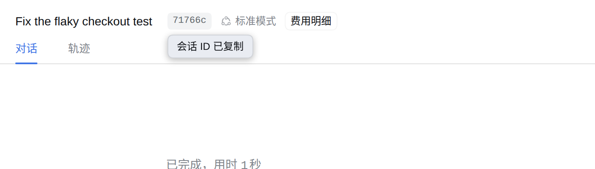

# dsh-session-id-copy

[English](README.md) · 简体中文

<p align="center">
  
</p>

*对话标题旁的 6 位徽标，以及点击后出现的复制提示。截图取自隔离的 DSH 实例，会话标题为合成内容。*


<!-- problem -->
DSH 会显示对话标题，却没有办法复制会话 id，而脚本、日志排查、提 issue 和 `dsh` 命令都要用到它。这个插件在标题旁加一个 6 位的小徽标，点一下就复制完整的 session id，并给出一句短提示。

**它给你什么**

- **id 只差一次点击。** 不用开 devtools、不用翻日志、也不用从 URL 里手抄 id。
- **标题保持官方原样。** 徽标只是标题区里多出的兄弟节点，标题、面包屑及其导航行为完全不变。
- **什么都不外发。** 没有 host 侧能力、不发网络请求、不保存数据，也不读取会话内容；只用到当前 session id。
- **实时跟随会话。** 切换会话或标题重新生成后，徽标立即更新。

## 安装

需要 DeepSeek Harness `0.2.0-rc.2`、Node.js `>=22.19`。

```sh
# 从 npm 安装——预构建，无需批准构建
dsh plugin --profile web add dsh-session-id-copy

# 或直接从源码安装——本地构建，dsh 询问时批准构建
dsh plugin --profile web add prgrmrwy/dsh-session-id-copy
```

重启 DSH 并刷新 Web 页面即可，无需任何配置。

## 行为

- 当前会话标题**右侧**出现徽标（`data-dsh-session-id-copy-badge`），显示去掉 `session-` 前缀后的 session id 前 6 位：`session-9af69be9-…` 显示为 `9af69b`。
- 真相源是官方 sessions list 的 `current`。会话切换和标题变化后，徽标文本与复制目标都会跟随；空白会话或 hero 视图没有标题区，因此不显示徽标。
- 点击复制**完整**的当前 session id。hover 时显示 pointer、底色和带完整 id 的 tooltip。复制成功后徽标下方出现瞬态提示，显示 1.2 秒后以 200 毫秒淡出；提示文案跟随界面语言（中文 / 英文）。
- 标题本身保持官方原样：仍是 `disabled`、cursor default、无点击行为。祖先面包屑行为不变，仍是打开对应会话，不复制。
- `MutationObserver`（子树与 class 变更）加 sessions 订阅触发经 rAF 防抖的 reconcile：徽标存在就原地更新，标题区重建就重建徽标，没有标题区就清除。

实现位置（DSH 升级后需回归）：

| 部分 | 文件 | 职责 |
|---|---|---|
| 官方 DOM 接缝 | `src/client/title-locator.ts` | 定位标题区里的面包屑 `nav`；唯一了解官方结构的文件 |
| 徽标与交互 | `src/client/wiring.ts` | 自有 marker、内联样式、tooltip、剪贴板调用与瞬态提示 |
| 状态同步 | `src/client/index.ts` | sessions 订阅、observer、rAF 防抖、清理 |
| 提示文案 | `src/client/locales.ts` | 当前界面语言下的提示文案 |
| Host 入口 | `src/index.ts` | 空 loader 入口（见[边界与安全](#边界与安全)） |

0.1.0 曾把标题本身做成点击复制；0.1.1 起交互改到徽标上，因为面包屑本来是导航控件，覆盖它并不易被发现。

## 配置

无。插件行没有任何 `config` 字段，包也不读取环境变量。

## 边界与安全

- **没有 host 能力。** Host 半区（`src/index.ts`）是空 loader 入口。它存在的结构原因只有一个：bundle 行会在启动时导入这个包，而正是这个入口让浏览器 bundle 变得可达。它没有网络、文件系统或会话副作用。
- **不联网、不落盘。** 浏览器半区只读官方 sessions list 与官方标题 DOM，点击时调用 `navigator.clipboard`。不写 `localStorage`、不写 cookie、不写文件，也不上传任何内容。
- **静默降级。** 官方 DOM 变化导致找不到面包屑时，不注入也不报错；剪贴板 API 不可用或被拒绝时保持静默。
- **不冒充官方 UI。** 徽标和提示都是插件自有元素（自有 marker、内联样式、官方设计 token 加回退值），从不改写官方 class 或事件处理器。
- **依赖。** Peer 依赖为 `@deepseek-ai/cordis`、`@deepseek-ai/dsh-api-session-controller` 与 `@deepseek-ai/dsh-client-locale`，版本跟随运行中的 DSH。

## 开发

`lib/` 是被 Git 忽略的构建产物。在独立检出中：

```sh
npm install
npm run typecheck
npm test
npm run build
```

在 ohmydsh 单仓中这个包是 workspace 成员：在仓库根目录安装一次，并在后三条命令后加 `--workspace dsh-session-id-copy`。`dsh build` / sync 也会在安装本地包前按需构建 `lib/`；刷新 Web 页面即可加载新的 client bundle。

官方结构变化时，应当只需要修 `src/client/title-locator.ts`；徽标、剪贴板与提示行为由 wiring 测试在无浏览器环境下断言。

## 移除

```sh
dsh plugin --profile web remove dsh-session-id-copy
```

重启 DSH 并刷新页面，徽标消失。插件不保存设置或文件，移除后不留数据。

## 来源、许可与参与

插件在 [ohmydsh](https://github.com/prgrmrwy/ohmydsh)（`packages/session-title-copy`）中持续开发；这个仓库是它的发布镜像，自动发布到 npm 与 GitHub Releases。当前行为见 [`openspec/specs/session-title-copy`](https://github.com/prgrmrwy/ohmydsh/blob/main/openspec/specs/session-title-copy/spec.md)；设计历史见已归档 change [`session-title-copy`](https://github.com/prgrmrwy/ohmydsh/tree/main/openspec/changes/archive/2026-09-01-session-title-copy) 与 [`session-title-id-badge`](https://github.com/prgrmrwy/ohmydsh/tree/main/openspec/changes/archive/2026-09-02-session-title-id-badge)。

代码为 [MIT](LICENSE)。欢迎在 [prgrmrwy/dsh-session-id-copy](https://github.com/prgrmrwy/dsh-session-id-copy/issues) 提 issue 或 PR。
