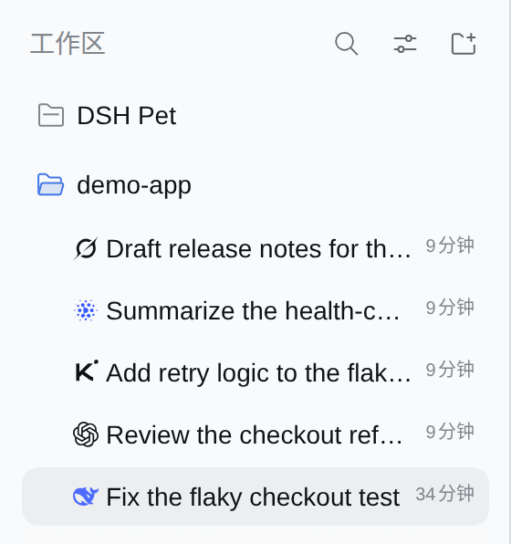
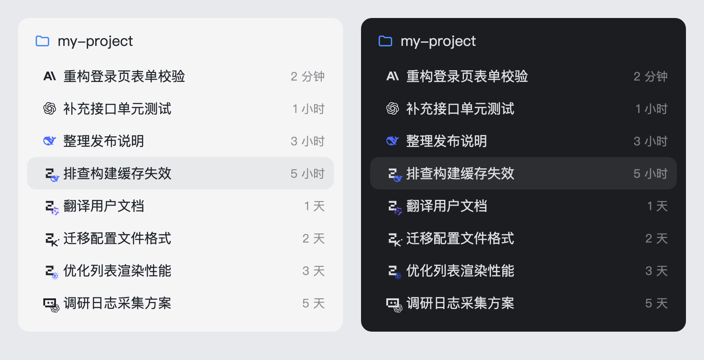

# dsh-sidebar-session-provider-icon

[](https://www.dsh.so/artifact/dsh-sidebar-session-provider-icon/)

[English](README.md) · 简体中文





<!-- problem -->
DeepSeek Harness（DSH）的侧边栏里每个会话行看起来都一样，不打开会话就分不清它用的是哪个 provider 和 model。这个插件在每个会话标题前显示 provider + model 图标，取值于输入框当前选中的模型，切换后立刻更新。provider 和 model 不是同一家时（例如 `opencode-go/deepseek-v4-flash`），在 provider logo 的右下角叠一个缩小的 model logo。

**安装。** 需要 DeepSeek Harness `0.2.0-rc.2`、Node.js `>=22.19`。

```sh
# 从 npm 安装：预构建，无需构建授权
dsh plugin --profile web add dsh-sidebar-session-provider-icon

# 或直接从源码安装：本地构建，dsh 请求授权时确认即可
dsh plugin --profile web add prgrmrwy/dsh-sidebar-session-provider-icon
```

重启 DSH 并刷新 Web 页面。除此之外不需要任何东西：无配置项、不访问网络、除安装它的 DSH profile 外不写任何文件。

在 ohmydsh 仓库里，本插件通过 `dsh.yaml` 的条目 `sidebar-session-provider-icon`（`source: local`）接入，因此在该仓库改源码只需 `dsh build` 再重启。当前行为见规范 [`openspec/specs/sidebar-session-provider-icon`](https://github.com/prgrmrwy/ohmydsh/blob/main/openspec/specs/sidebar-session-provider-icon/spec.md)；设计演进见归档的 change [`sidebar-session-provider-icon`](https://github.com/prgrmrwy/ohmydsh/tree/main/openspec/changes/archive/2026-08-21-sidebar-session-provider-icon) 和 [`sidebar-provider-icon-composite-model-badge`](https://github.com/prgrmrwy/ohmydsh/tree/main/openspec/changes/archive/2026-10-10-sidebar-provider-icon-composite-model-badge)。

## 行为

会话显示哪个 logo，按以下顺序取数据：

1. **即时选择（优先，且须可核验）。** 官方 `dsh-client-ui-model-selection` 的 store，读作 `ctx.modelDirectories.directoryFor(sessionId).store.current`。它是输入框选择器与 `/model` 命令共享的唯一 per-session 状态，`session.selectModel` 成功后立即发布 `{ provider, model }`。因此当前打开的会话（包括还没发过消息的空白会话）按输入框的选择显示。该 store 属于客户端 Session scope：每次会话列表 / DOM 信号都会重新解析，运行体给同一个 session 换了新 store（离开会话再回来就会发生）时立即重订阅并重读，身份未变时也重读快照。观测值只在其 session 仍是当前打开会话、且该目录仍可解析期间保留；视图离开或目录不再可解析时即丢弃——不再让客户端无法核验的旧值决定某一行的 logo。
2. **已选模型（持久）。** 官方 `modelSelection` 投影的 `next`，即该 session 下一次请求将使用的选择。它由 Host 维护，也覆盖"已选但尚未发送"的选择，因此离开会话之后该行仍然正确。
3. **最近一次请求（冷历史 fallback）。** Host 的 `provider` session projection 折叠会话日志中的 `request/header` 事件，所以尚未在本浏览器加载选择器的历史会话，仍会显示它最近一次真实请求的 provider。重启不丢，不使用 `localStorage`。

品牌判断分两个独立维度：provider route 决定**主图**，model id 决定**右下角小图标**。

| 选择 | 显示 |
|---|---|
| `claude/claude-opus-5`、`codex/gpt-6-luna`、`deepseek-official/deepseek-v4-pro`（同品牌） | 单一 Anthropic / OpenAI / DeepSeek logo |
| `opencode-go/deepseek-v4-flash`、`opencode-go/qwen3.8-flash`、`opencode-go/kimi-k2.7-code` | OpenCode 主图，右下角 DeepSeek / Qwen / Kimi |
| `traex/GPT-5.6-Sol[1m]`、`traex/DeepSeek-V4-Flash`、`traex/Gemini-3.1-Pro-Preview` | Trae 主图，右下角 OpenAI / DeepSeek / Gemini |
| `traex/openrouter-3o[1m]`、`traex/Seed-2.1-Pro-0915` | Trae 主图，右下角 OpenRouter / ByteDance |
| `dsh-magpie-connect` + `claude/claude-haiku-5-5`、`codex/gpt-6-luna`、`opencode-go/deepseek-v4-flash`（Magpie 网关） | Magpie 主图，右下角 Anthropic / OpenAI / OpenCode |
| 已知 route + 认不出的 model（如 `opencode-go/omen-alpha`） | 只显示 route 品牌，不叠小图标 |
| 未知或通用 route | 按 model 名显示单一 logo；仍匹配不上时显示中性的单字母徽标 |

- **route 优先。** `opencode-go/deepseek-v4-flash` 的主图是 OpenCode；DeepSeek 只会出现在右下角。
- **认不出不冒充。** 查不到厂商的模型不加小图标，也不会用单字母徽标充当小图标。
- **尺寸。** 复合图标的外框和单一 logo 一样是 14×14，行布局不变。右下角是 10px 的品牌图形本身，向右下溢出 4px，没有圆底、描边或内边距——在这个尺度下任何装饰都会挤掉图形需要的像素。
- **悬停提示。** 始终显示精确的 `provider · model`。

| 层 | 实现 |
|---|---|
| Host | `src/provider.ts` 注册 `provider` projection（依赖 `sessionProjections` 服务），折叠 `request/header`；只承担冷历史 fallback |
| Client 数据 | `selection-binding.ts` 观测当前打开会话的 `ctx.modelDirectories` store（每次信号重新解析）；`provider-map.ts` 依次取：可核验的即时观测 → 官方 `modelSelection` 选择 → `provider` fallback |
| Client DOM | `row-locator.ts` 收拢全部官方行 DOM 知识：每行按官方 `data-row-key="session:<id>"` 精确定位（标题反查仅作为没有该属性时的 fallback），因此同名会话不会互相串用徽标；`MutationObserver` 在标题前维护独立的 badge `<span>` |
| 品牌图 | `src/client/assets/*.svg`，一次下载并随包打入；`logos.ts` 分别判定 provider 品牌与 model 品牌，不同时渲染复合图标 |

徽标内容只由 `(provider, model)` 决定；`index.ts` 只在这两个值或悬停提示变化时重建徽标。

## 配置

无。插件行没有任何 `config` 字段，也不读取环境变量。

可识别的品牌：

| 维度 | 品牌 |
|---|---|
| provider 与 model | DeepSeek、OpenAI/GPT/Codex、Anthropic/Claude、Grok/xAI、Kimi/Moonshot、GLM（智谱）、MiniMax、Pi、OpenClaw、Hermes Agent（也接受 `hermas` 拼写）、OpenCode、Qwen、腾讯混元（`hy3`、`hy4-*`）、美团 LongCat、小米 MiMo、Gemini/Gemma、NVIDIA（Nemotron）、Meta（Muse Spark、Llama）、蚂蚁（Ling/Ring）、OpenRouter、ByteDance Seed |
| 仅 provider | Trae（`trae`、`trae-ai`、`traex*`；按完整名或前缀匹配，不按子串）、Magpie（`magpie`、`magpie-*` 及插件 route `dsh-magpie-connect`；按完整名或前缀匹配） |

model 维度覆盖 OpenCode Go / Zen 模型目录里所有能确认厂商的模型族，并覆盖当前 TraeX 目录中的 GPT、DeepSeek、Gemini、OpenRouter 与 ByteDance Seed 系列。

网关型 route（Magpie）下，model id 形如 `<上游 provider>/<model>`：右下角小图标先按 `/` 前的上游段当作 provider route 识别（`claude` → Anthropic、`opencode-go` → OpenCode），上游段认不出（`auto/`、`group/`、自定义 id）时才按 `/` 后的模型名识别。其它 route 仍按整个 model id 识别。

品牌图是固定版本并随包落盘的，不手绘，运行时也不访问 CDN：

- 除 OpenCode、Magpie 外的所有品牌：`@lobehub/icons-static-svg@1.94.0`，MIT；有彩色版时用彩色版；
- OpenCode：`anomalyco/opencode` commit `5e75e5e9901f0d178f425bfb47f1bd46cbe78a59` 中的官方 provider SVG，MIT；
- Magpie：`yetone/magpie` commit `ba1dc7f975666e50308ef7bf8173c8a8e91c553b` 中的官方标志 `internal/provider/magpie.svg`，MIT。

逐个文件的来源 URL 与 SHA-256 校验值见 [`src/client/assets/README.md`](src/client/assets/README.md)。部分彩色 SVG 内含渐变/裁剪 id；右下角实例会给它们加 `-sub` 后缀，避免同一页面的多份 SVG 串用定义。

新增品牌：把 SVG 放进 `src/client/assets/`，在 assets README 记录来源、版本、许可和 SHA-256，再在 `logos.ts` 的 `providerBrandOf` / `modelBrandOf` 里补规则和测试。

## 边界与安全

- 官方 `StateDot` 不会被替换、移动或隐藏；时间、行菜单和拖拽行为保持官方原样。
- badge 是标题前的独立 `<span>`。DOM 无法可靠定位时，插件静默不显示，不破坏页面。
- 自身不发起网络请求：logo 随 bundle 提供，数据来自 DSH 自己的 store 与会话日志。
- 代码为 MIT 许可（[LICENSE](LICENSE)）。品牌图标来自 MIT 许可的上游；其版权声明、渲染时的确切改动与商标立场见 [THIRD-PARTY-NOTICES.md](THIRD-PARTY-NOTICES.md)。品牌方保留其商标权利；这些标识只用于标明所选的 provider route 和 model，不暗示任何背书。

## 开发

`lib/` 是被 git 忽略的构建产物。独立检出时：

```sh
npm install
npm run typecheck
npm test
npm run build
```

在 ohmydsh monorepo 里本包是 workspace 成员：在仓库根目录安装一次，后三条命令加上 `--workspace dsh-sidebar-session-provider-icon`。`dsh build` / sync 也会在安装本 local package 之前按需生成 `lib/`；刷新 Web 页面即可加载新的 client bundle。

vitest 下小 SVG 会被内联成 data URL，属性引号会被改成 `'`。改写 SVG 属性的正则要同时兼容 `"` 和 `'`。
