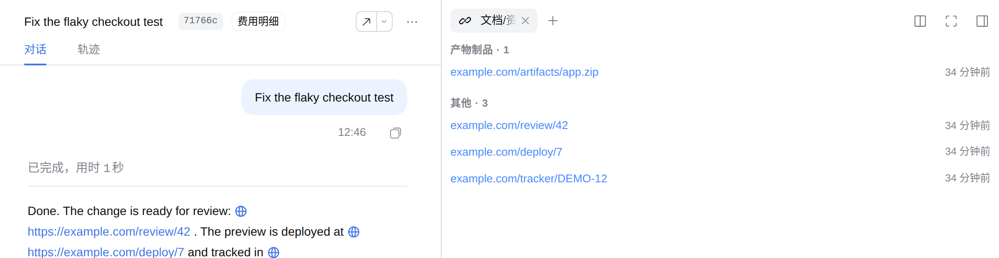

# dsh-sidebar-session-resources

[English](README.md) · 简体中文



<!-- problem -->
在很长的 Agent 对话里，你要找的合并请求、部署页面、工单或制品链接早已淹没在上文，Agent 写出的文件同样不好找。这个插件把它们收集到当前会话的一个侧边面板里，按类别分组，一点就能打开。

**安装。** 通过 `dsh.yaml` 管理（条目 `sidebar-session-resources`，`source: local`）：设为 `enabled: true`，运行 `dsh build`，然后重启 DSH。它依赖第三方 `better-sidebar` 插件（`dsh-better-sidebar`，peer `>=0.16.0`，可选）：没有它时本插件完全不激活。设计见 OpenSpec change `sidebar-session-resources-panel`。

## 行为

面板是 `better-sidebar` 的工作台 tab，id 为 `sidebar-session-resources`，界面上的名称是**文档/资料**。它是单实例，跟随当前会话，并把找到的内容分成：

- **链接**，固定顺序：MR、部署、工作项、产物制品、其他。组内按出现时间倒序，同一时间 assistant 来源的链接优先于其他来源。每条显示可读标题（host 加路径摘要）、相对时间和重复次数；点击在新标签页打开 URL，不注入任何脚本。
- **本次产出**：会话中成功写入或编辑的文件。读取、删除和失败的调用不算，同一文件先写后改只保留一条。每行显示文件名及 **远端完整路径**，由 Host 按所属会话解析（含 Worktree 执行目录），支持「复制路径」；点击文件名在侧边栏编辑器打开同一文件。
- **下载到当前设备**：点击文件行的「下载」，从运行 DSH 的主机读取原始字节，再由当前浏览器保存到本地。PDF、图片、压缩包及文本均保留原始内容；中文、空格、`#`、`%` 等路径字符原样传递。浏览器决定保存位置，面板只提示「已请求浏览器下载」，不会把远端路径当成本地保存位置。

对话中通过 `present` 展示的官方文件卡片也在右侧提供 **下载图标**，悬停提示「下载到本地」。点击卡片主体仍在侧边栏预览；下载按钮按所属会话与原始声明定位文件，不依赖远端桌面，也不依赖侧栏的历史产出基线。已有卡片在刷新页面加载新插件后即可使用。

采集范围：user、assistant、steering、context 消息。assistant 消息只扫描可见的 text 块，不含 reasoning 和 tool-call 载荷；tool-result、compaction 等节点会跳过。重复的 URL 会合并，保留最近一次出现并计数。

数据怎么来：

- **整份日志基线。** host 半区注册只读的 `/dsh-sidebar-session-resources` Connection RPC 通道（端点 `links`），通过 `sessionPersistence` 读取该会话完整的持久化事件日志，所以被“加载更多”折叠或被 compaction 替换掉的历史链接依然能显示。结果按会话缓存 30 秒。
- **增量。** 基线之后，浏览器半区只处理超过单调 `seq` 水位的新消息，每个会话最多完整扫描一次。重复应用基线不会重复计数。
- **规则。** 分类集中在一张有序规则表里，即 `src/shared/links.ts` 的 `CATEGORY_RULES`（先匹配者生效；不匹配的 URL 进“其他”，绝不丢弃）。它识别公开平台（`gitlab`、`github`、`bitbucket`、`gitee` 域名），以及部署和制品链接的 host、路径、查询特征。扩展规则就是改这张表并同步测试。

## 配置

组织专属的域名属于配置，不属于源码。写在插件行的 `config` 里，通常经由私有 overlay 的 patch 覆盖本插件行：

```yaml
- id: sidebar-session-resources
  name: dsh-sidebar-session-resources
  config:
    reviewHosts: [git.corp.example]      # 额外的 MR/PR 域名（含子域名）
    trackerHosts: [tracker.corp.example] # 归入“工作项”的域名（含子域名）
```

| 键 | 默认值 | 含义 |
|---|---|---|
| `reviewHosts` | `[]` | 公开平台之外额外的代码评审域名 |
| `trackerHosts` | `[]` | 其链接归为工作项的域名；未配置时“工作项”分组为空 |

条目会转成小写、去空白并按主机名格式校验，非法条目被丢弃。host 把这些规则连同基线一起下发给浏览器，两边分类一致。

## 边界与安全

- 0.2.0 起要求 DSH `>=0.2.2-rc.1`。路径和下载复用官方 `workspaceFiles` 与 `fileActions`，文件权限按所属会话校验，不新增任意路径读取接口。
- 单文件下载遵守官方完整读取上限（默认 **32 MiB**）；超限、目录、最终符号链接、已删除文件或权限不足会显示错误，不下载截断内容。暂不支持目录打包和批量下载。
- 下载进行中显示忙碌状态，切换会话或关闭面板会取消未完成的读取。复制路径需要浏览器 Clipboard API；不可用时仍可手动选中路径复制。
- 不向外部服务发送文件或会话数据，不用 CDN，不读写凭据。流量仅在浏览器与 DSH Host 之间，沿用官方 Connection 认证与 Host/Origin 围栏。
- 不持久化任何内容。刷新后会为当前会话重建一次集合。面板展示的是当前快照与日志里有的内容，而不是 host 侧的查询历史。
- 快照结构变化、host 缺失或没有当前会话时，安全降级为空态；host 基线失败时，面板仍显示实时快照里可见的链接。其他 tab 不受影响。
- 采集过程不修改官方会话数据，只保留提取出的条目，不保留消息正文。

## 开发

在仓库根目录运行：

```sh
npm install
npm run typecheck --workspace dsh-sidebar-session-resources   # tsc host + client
npm test --workspace dsh-sidebar-session-resources            # vitest：links / collector / extraction
npm run build --workspace dsh-sidebar-session-resources       # host (tsc) + client (tsdown) -> lib/
```
